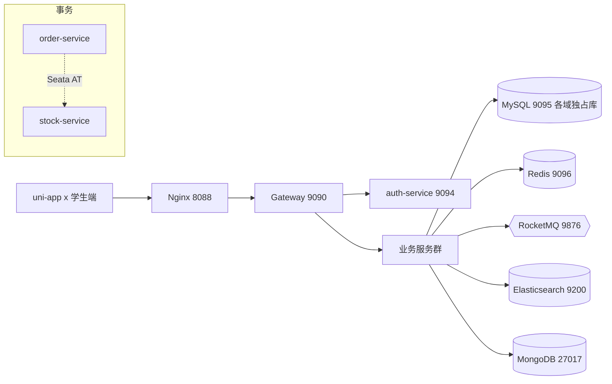

# 校园食堂点餐系统

基于 Spring Cloud 的校园食堂点餐系统后端：用户可以浏览食堂与窗口、搜索菜品、管理购物车、领券下单、余额或渠道支付、评价菜品，并获得订单通知与商家聊天能力；配套库存、销量榜、推荐、全文搜索、帮助反馈等域服务。学生端为独立 uni-app x 仓库，通过网关与本系统交互。

> 仓库中的代码、迁移脚本与文档可能处于不同实施阶段：**有源码不等于已完成端到端验收**。各模块的已知限制与未验证项见对应 README。

## 技术选型

| 类别 | 技术 | 作用 |
|---|---|---|
| 语言与运行时 | Java 21 | 全部后端服务与共享模块 |
| 应用框架 | Spring Boot 3.5 | Web、安全、配置与自动装配 |
| 微服务 | Spring Cloud 2025 + Spring Cloud Alibaba | 网关、注册配置中心、服务调用、熔断限流 |
| 网关 | Spring Cloud Gateway（WebFlux） | 统一入口、认证、限流、路由 |
| 注册与配置 | Nacos | 服务发现、网关路由集中管理 |
| 服务保护 | Sentinel、OpenFeign | 流控降级、声明式调用 |
| 认证 | Spring Security + RSA JWT + Redis | 无状态令牌、注销黑名单、凭据版本 |
| 关系数据 | MySQL 8 + MyBatis-Plus + Druid | 各域独占库，注解 SQL 优先 |
| 缓存 | Redis 7 + Redisson + Lua | 购物车、榜单缓存、令牌状态、分布式锁、原子脚本 |
| 消息 | RocketMQ 5 + Spring Cloud Stream | 事件驱动投影，Outbox 模式可靠发布 |
| 分布式事务 | Seata AT（+ 取消通知 TCC） | 下单/取消跨服务事务 |
| 检索 | Elasticsearch 8 | 菜品全文搜索 |
| 文档数据 | MongoDB 7 | 评价正文/图片/标签 |
| 链路追踪 | SkyWalking + BanyanDB | 跨服务 Trace 与拓扑 |
| 文档 | springdoc-openapi | 网关聚合各服务 OpenAPI |
| 本地基础设施 | Docker Compose | MySQL/Redis/Nacos/MQ/ES/Seata/SkyWalking |

版本以根 `pom.xml` 与 `docker-compose.yml` 为准。

## 系统架构



- 所有请求经 Nginx → 网关；网关完成登录限流、JWT 验签与注销黑名单校验后转发。
- 服务间同步调用走 OpenFeign + 共享内部令牌；异步事件走 RocketMQ，生产方一律 Outbox 模式。
- 下单/取消使用 Seata AT 协调订单、库存、优惠券三个库；支付、账务等关键路径以幂等条件更新与重试保证最终一致。

## 模块目录

### 入口与认证

| 模块 | 端口 | 说明 |
|---|---|---|
| [gateway-service](gateway-service/README.md) | 9090 | 统一入口：限流、认证、路由、CORS、WebSocket、文档聚合 |
| [auth-service](auth-service/README.md) | 9094 | 登录/注册编排、验证码、双令牌、注销冷静期拦截（无数据库） |

### 业务服务

| 模块 | 端口 | 数据库 | 职责 |
|---|---|---|---|
| [user-service](user-service/README.md) | 9092 | user_db | 账号、角色与数据范围、余额账务（唯一权威）、支付密码、邮箱、收藏、账号注销 |
| [product-service](product-service/README.md) | 9093 | product_db | 餐厅/窗口/分类/菜品/规格、报价、评分投影、搜索与推荐数据源 |
| [order-service](order-service/README.md) | 9091 | order_db | 订单状态机、Seata 下单、支付推进、超时关单、取餐码、退款、事件发布 |
| [payment-service](payment-service/README.md) | 9101 | payment_db | 支付单生命周期、余额渠道编排（扣款/入账委托用户服务）、渠道回调、关单与退款协作 |
| [coupon-service](coupon-service/README.md) | 9113 | coupon_db | 平台满减券：模板、领取、锁券、核销、释放 |
| [stock-service](stock-service/README.md) | 9104 | stock_db | 库存扣减/回补、流水、快照缓存、对账（纯内部接口） |
| [cart-service](cart-service/README.md) | 9103 | 无（Redis） | 购物车与下单后清理，Lua 保证原子性 |
| [comment-service](comment-service/README.md) | 9105 | comment_db（MySQL+Mongo） | 菜品/窗口评价、评分聚合与事件 |
| [notification-service](notification-service/README.md) | 9107 | notification_db | 站内通知、持久化系统会话（订单中心）、订单聊天、WebSocket、通知偏好 |
| [support-service](support-service/README.md) | 9114 | support_db | 帮助反馈工单（用餐问题必须关联本人订单）、注销阻断计数 |
| [statistics-service](statistics-service/README.md) | 9111 | statistics_db | 销量投影与榜单（口径唯一所有者） |
| [recommendation-service](recommendation-service/README.md) | 9112 | recommendation_db | 首页可解释推荐（rule-v1） |
| [search-service](search-service/README.md) | 9106 | Elasticsearch | 菜品搜索与索引维护 |
| [file-service](file-service/README.md) | 9102 | file_db + 本地磁盘 | 图片上传、归属校验、逻辑删除 |

### 共享模块

| 模块 | 说明 |
|---|---|
| [common-core](common-core/README.md) | 错误码、业务异常、角色与数据范围模型 |
| [common-response](common-response/README.md) | 统一响应体 `ApiResponse{code,message,data}` |
| [common-redis](common-redis/README.md) | Redis 同步/响应式封装、分布式锁、布隆过滤器 |
| [common-web](common-web/README.md) | 全局异常、JWT 身份转换、内部令牌、图片归属、审计 |
| [user-api](user-api/README.md) / [order-api](order-api/README.md) / [product-api](product-api/README.md) / [stock-api](stock-api/README.md) / [coupon-api](coupon-api/README.md) / [comment-api](comment-api/README.md) | 各域 Feign 契约、降级约定与事件模型 |

## 跨模块业务链路

### 下单支付

1. 加购：购物车服务先经商品服务核价，Redis Lua 原子写入。
2. 下单：订单服务持幂等键发起 Seata 全局事务——商品报价 → 优惠券锁券（如有）→ 库存扣减 → 订单落库；任一失败全局回滚。
3. 支付：支付服务创建支付单（余额渠道同步结算扣用户余额；模拟渠道异步回调验签），确认后推进订单为已支付并写入支付时间。
4. 已支付事务内写四类 Outbox：销量（统计服务投影）、订单通知（通知服务推送）、优惠券核销（券服务核销后回执）、推荐购买快照（推荐服务投影）。

### 履约与售后

- 商家推进状态、凭取餐码核销完成订单（限流 + 审计 + 常量时间比较）。
- 待支付超时经 `order-payment-timeout-v1` 自消费取消并回补库存，死信留痕待人工。
- 退款：明细级申请 → 商家/管理员裁决 → 顾客申诉 → 执行任务「先退资金再回库存」，按退款号幂等重试。

### 数据投影链

| topic | 生产 → 消费 | 用途 |
|---|---|---|
| `order-paid-sales-v2` | 订单 → 统计（+自投影） | 销量榜（退款不冲减） |
| `recommendation-purchase-snapshot-v1` | 订单 → 推荐 | 购买偏好投影 |
| `order-status-notification-v1` | 订单 → 通知 | 站内信与实时提示 |
| `order-payment-timeout-v1` | 订单 → 自消费 | 支付超时关单 |
| `order-coupon-paid-v1` | 订单 → 优惠券 | 券核销 |
| `product-search-refresh-v1` | 商品 → 搜索/推荐 | 搜索索引与推荐目录刷新 |
| `product-rating-changed-v1` | 评价 → 商品 | 商品评分投影 |
| `stock-changed-v1` | 库存 → 自消费 | 库存快照失效 |
| `user-favorite-changed-v1` | 用户 → 推荐 | 收藏偏好投影 |

所有事件以数据库 Outbox + 定时发布 + 指数退避重试 + 消费端唯一键幂等保证最终一致。

### 认证与会话

登录（图片验证码 + 失败锁定）→ 认证服务签发访问令牌（30 分钟）与刷新令牌（30 天，轮换 + Redisson 锁）→ 资源服务验签 + jti 黑名单 + 凭据版本校验。注销冷静期账号登录只返回待注销状态与 10 分钟一次性撤回令牌，不签发正常令牌。

## 数据库与中间件

| 中间件 | 端口 | 说明 |
|---|---|---|
| MySQL 8 | 9095 | 各域独占库：user/product/order/payment/stock/coupon/comment/notification/statistics/recommendation/support/file |
| Redis 7 | 9096 | 黑名单、购物车、榜单缓存、票据、限流、验证码 |
| Nacos | 9097（控制台 9098） | 注册中心；网关路由经配置发布 |
| Seata TC | 9109（控制台 9108） | 下单/取消全局事务 |
| RocketMQ | 9876 | 事件总线，topic 随 docker compose 初始化 |
| Elasticsearch | 9200 | `menu-products-current` 别名索引 |
| MongoDB | 27017 | 评价正文集合 |
| SkyWalking | 11800/12800（UI 18080） | 链路追踪 |
| Nginx | 8088 | 学生端静态资源与 API 转发 |

迁移脚本统一在 `docs/database/migrations/{库名}/`，按版本号命名并附执行记录。

## 本地环境

```bash
# 基础设施（必选）
docker compose up -d mysql redis nacos seata
# 按需启用
docker compose --profile mq up -d          # RocketMQ
docker compose --profile comment up -d     # MongoDB
docker compose --profile search up -d      # Elasticsearch
docker compose --profile skywalking up -d  # 链路追踪
docker compose --profile edge up -d        # Nginx
```

- 环境变量见 `docker-compose.yml`、根 `.env` 与各服务 `application.yml`（数据库连接、Redis、JWT 密钥路径、`internal.scope.token`、SMTP 等）。
- 开发库凭据：业务账号按域分配（如 order_db/order_user），root 为开发专用弱口令，生产前全部更换。
- Nacos 首次启动需在控制台设置密码并回写根 `.env` 的 `NACOS_USERNAME`/`NACOS_PASSWORD`。
- IDEA 直启网关需设置 `NACOS_SERVER_ADDR=127.0.0.1:9097` 等环境变量；网关容器与 IDEA 进程不可同时启动（同占 9090）。
- `docker compose down -v` 会删除 MySQL/Nacos 数据卷，执行前确认。
- 服务间共享令牌 `internal.scope.token` 各服务必须取值一致；`/internal/**` 路径不经网关暴露。
- 网关路由来自 Nacos 配置 `gateway-service.yaml`（发布源见 `docs/nacos/`）。
- 启动顺序建议：基础设施 → Nacos 发布路由 → 各业务服务 → 网关。

## 数据访问与可观测性约定

- 连接池：Druid starter 1.2.27（根 POM 统一管版本），仅七个 MySQL 服务使用并排除 HikariCP；初始/最小空闲连接 1、最大 10（评价服务 5）、获取等待 3 秒、空闲检测 `SELECT 1`；监控 Servlet 与 Web Filter 一律关闭，不发布监控入口；会话时区固定 UTC+8。
- 链路追踪：版本组合必须成组固定（OAP 11.1.0-java21 + BanyanDB 0.11.2 + Horizon 1.1.0 + Agent 9.8.0，禁用滚动 latest）；数据留存 TTL——Trace 3 天、分钟级指标 7 天；需复制 `apm-springmvc-annotation-6.x` 与 `apm-spring-cloud-gateway-4.x` 两个可选插件（不得复制 webflux 插件，Agent 路径缺失会导致 JVM 启动失败）；OAP 管理 API 端口 17128 仅绑定本机回环、无内置认证；Horizon 管理员密码与哈希存于 `.env`；RocketMQ 5.x Agent 插件与 Stream Binder 的上下文传播尚未验收，Trace 断链时需补最小适配；首期不启用日志采集、持续剖析与自定义业务指标。

## 编码规范

- 分层分包：DO/DTO/VO/BO 分包（`dto.request`/`vo`/`enums`），Controller 不返回 DO，不并存 PO/DO。
- 金额一律 `BigDecimal` 并用 `compareTo` 比较，禁用 `float/double`；分页必须限制 pageSize；批量操作控制批次大小；状态流转用条件更新或版本号防并发覆盖。
- 事务注解放在 Service 层且范围最小；统一构造器注入；日志参数化且禁止输出密码、Token 等敏感信息。
- 注释统一中文；业务代码少用 Lambda/Stream 链式调用。
- 详见 `docs/JAVA_CODING_STANDARDS.md`。

## 系统边界

- 当前共 16 个可运行服务（2 个入口 + 14 个业务服务）：新增服务必须先回答「能学到什么新技术」，否则并入现有服务。
- 已评估可合并项：statistics 与 recommendation 同为 MQ 投影读模型，可合并为一个投影服务；stock 仅服务下单扣减，可并入 product。当前保留独立主要用于覆盖不同技术点，全量启动约需 4–6GB 内存，按链路按需启动即可。
- Postman 集合导出在 `docs/postman/`（网关合并版 + 各服务直连版）。

## 共享约定

- 统一响应体 `ApiResponse{code, message, data}`，成功码 `COMMON_000`；业务失败常以 HTTP 200 + 业务码表达（内部接口），HTTP 状态由 Web 边界映射。
- 错误码：通用码在 `CommonErrorCode`，业务码形如 `STOCK_409_01` 留在各域。
- 对外令牌 sub 为 UUID，业务代码使用 `JwtUserIdentity` 转换后的内部用户 ID；`credential_version` 保证密码重置/注销后旧令牌失效。
- Feign 降级 fail-closed：涉及资金与事实的客户端刻意不配降级；其余统一返回服务不可用，绝不伪造成功。
- Mapper 层 MyBatis-Plus 注解 SQL 优先，复杂动态 SQL 用 XML；业务值一律 `#{...}` 参数绑定。

## 文档索引

- 各模块详细设计见「模块目录」中的链接（模块定位、技术栈、数据模型、业务流程、接口清单、配置项、失败行为、已知限制）。
- 迁移执行记录：`docs/database/`。
- 各服务专项设计与 API 说明：`docs/*.md`（订单、支付超时、退款、销量榜、库存集成、购物车、评价、通知、推荐、优惠券、登录、钱包、邮箱归属、密码找回等）。
- 学生端开发计划与设计稿：`docs/superpowers/plans/`、`docs/superpowers/specs/`。
- Nacos 配置发布源：`docs/nacos/`；Postman 集合：`docs/postman/`。

## 当前状态与已知限制

- 学生端功能（uni-app x 独立仓库）：点餐、支付、评价、通知、反馈、账号安全与注销已实现；商家与管理端功能规划接入独立 Vue 管理端，uni-app 仅保留 CUSTOMER 能力。
- 支付渠道仅余额与模拟渠道，真实渠道未接入；真实邮件、跨服务注销联调、冷静期到期任务等运行验收见各模块「已知限制与未验证项」。
- 全链路压测与多实例并发验证未完成。
