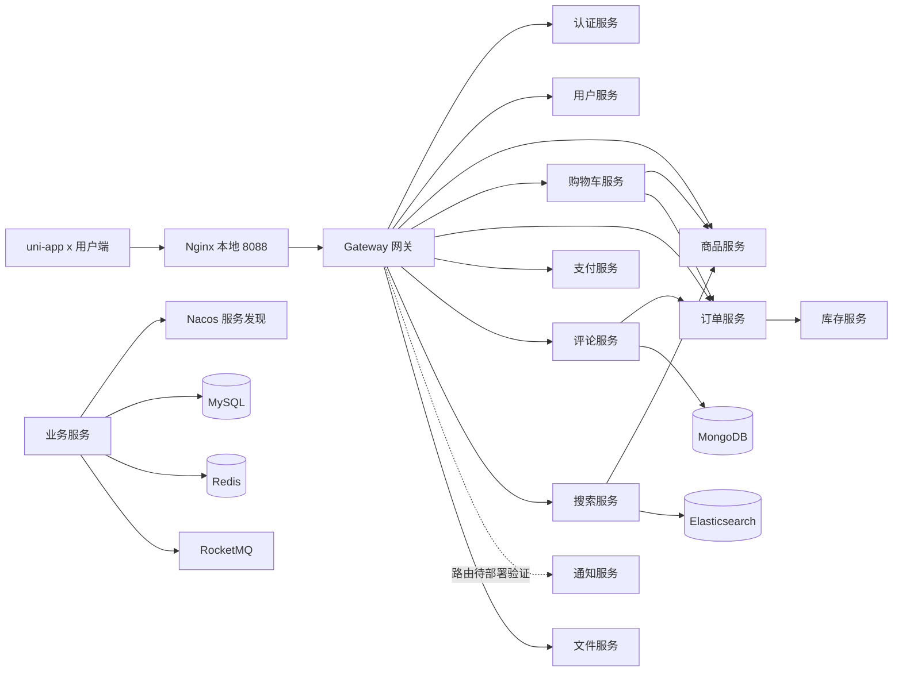

# 校园食堂点餐系统

基于 Spring Cloud 的校园食堂点餐系统，包含用户端和按业务拆分的后端服务。用户可以浏览食堂和窗口、搜索菜品、管理购物车、下单支付、查看订单及评价；后端还提供库存、销量榜、图片文件、搜索和订单通知等能力。

项目同时用于学习微服务中的服务治理、缓存、消息队列、分布式事务和多种数据存储。仓库中的代码、迁移脚本和历史记录可能处于不同实施阶段：**有源码不等于已经部署或完成端到端验收**。具体环境应以当前配置、数据库结构与实际运行结果为准。

## 内容导航

- [技术选型](#技术选型)
- [系统架构](#系统架构)
- [模块与职责](#模块与职责)
- [代码分层](#代码分层)
- [各模块具体实现](#各模块具体实现)
- [跨模块业务链路](#跨模块业务链路)
- [数据库与中间件](#数据库与中间件)
- [本地环境](#本地环境)
- [接口与前端](#接口与前端)
- [故障排查](#故障排查)
- [当前限制与后续计划](#当前限制与后续计划)
- [数据库字段参考](#数据库字段参考)
- [开发规范](#开发规范)
- [商家与顾客沟通规划](#商家与顾客沟通规划)

## 技术选型

| 类别 | 技术 | 在项目中的作用 |
| --- | --- | --- |
| 语言与运行时 | Java 21 | 后端服务与共享模块 |
| 应用框架 | Spring Boot 3.5.6 | 服务启动、Web、配置与自动装配 |
| 微服务 | Spring Cloud 2025.0.0、Spring Cloud Alibaba 2025.0.0.0 | 网关、服务治理、服务间调用与中间件集成 |
| 网关与服务发现 | Spring Cloud Gateway、Nacos | 请求路由、服务注册与发现，部分配置集中管理 |
| 对外接入 | Nginx 1.27 | 本地托管用户端 Web 产物并提供 API 与 WebSocket 转发；HTTPS 和网关多实例负载均衡仍为规划 |
| 服务调用与保护 | OpenFeign、Sentinel | 服务间接口调用、超时和降级等保护 |
| 认证授权 | Spring Security、JWT、Redis | 登录令牌、角色权限、注销黑名单 |
| 关系数据访问 | MySQL 8、MyBatis-Plus、Druid | 持久化业务数据、Mapper 数据访问、连接池 |
| 缓存与数据结构 | Redis 7.4、Redisson、Lua | 购物车、令牌状态、分布式锁、排行榜与原子操作 |
| 消息 | RocketMQ 5.3.2、Spring Cloud Stream | 发布业务事件，驱动异步投影与缓存处理 |
| 分布式事务 | Seata 2.5 | 订单与库存跨服务事务；取消通知另有待验证的 TCC 方案 |
| 全文检索 | Elasticsearch 8.19.4 | 建立菜品搜索索引 |
| 文档数据 | MongoDB 7 | 存放评价正文、图片和标签等文档内容 |
| API 文档 | springdoc-openapi 2.9.1 | 从接口代码生成 OpenAPI 文档 |
| 用户端 | uni-app x、Vue 3、UTS | 多页面点餐应用；项目配置启用 Vapor 模式 |
| 本地基础设施 | Docker Compose | 启动 MySQL、Redis、Nacos 等开发依赖 |

以上版本依据当前根 `pom.xml` 和 `docker-compose.yml`，以文件中的实际配置为准。技术选型服务于项目学习与业务实践；上线环境仍需评估容量、可用性和运维成本。

### 为什么选择这些技术

项目以校园点餐业务为载体，也有明确的分布式技术学习目标。微服务、消息队列、搜索引擎等选型不意味着同等规模的系统都必须这样拆分：它们提高了技术覆盖面，也增加了部署、排错和一致性成本。

| 技术 | 选择理由 | 引入的代价或边界 |
| --- | --- | --- |
| Spring Boot / Spring Cloud | Spring 生态提供成熟的 Web、配置、依赖注入与服务治理能力，适合用统一的 Java 技术栈组织多个服务 | 版本兼容和依赖管理复杂，服务越多，启动和内存成本越高 |
| Gateway + Nacos | 一个网关统一处理入口路由；Nacos 让服务按名称发现实例并集中管理部分配置 | 网关和注册中心成为重要基础设施；配置发布、gRPC 连通性和可用性必须维护 |
| Nginx | 放在网关前提供统一入口；后续可扩展 HTTPS、静态资源服务和多个网关实例间的流量分配 | 增加代理层和部署配置；WebSocket、真实客户端地址、超时与证书维护都需要专门验证 |
| OpenFeign + Sentinel | Feign 把同步服务调用表达为接口契约，Sentinel 提供流控和降级等保护手段 | 远程调用有超时、网络故障和部分失败；降级不能伪造库存、价格等关键业务事实 |
| MySQL + MyBatis-Plus | 订单、库存、余额、关系元数据需要事务、约束和条件更新；Mapper 便于控制 SQL 与业务表映射 | 跨服务事务不能依赖单库事务解决；索引、迁移、锁与慢查询需要维护 |
| Druid | 统一数据库连接池配置，限制每个实例的连接数量并管理连接生命周期 | 实例扩容会累加连接数，池大小和数据库容量需要一起规划 |
| Redis | Hash 适合存购物车，ZSet 适合按销量排序，TTL 适合短期令牌与缓存；低延迟适用于高频读写 | 内存有限；缓存和投影可能丢失或过期，需要持久化、回源、重建和故障策略 |
| Lua | 将 Redis 内的检查和写入组织为一次执行，避免多请求交错造成容量或去重竞态 | 脚本执行期间会占用 Redis 执行线程，且发生错误不会撤销已执行的写入 |
| Redisson | 复用分布式锁能力，协调多实例之间的令牌轮换和投影重建等任务 | 锁超时、续期、故障和旧执行者的问题仍需结合业务处理；不能把锁视为数据库事务 |
| RocketMQ + Spring Cloud Stream | 将可异步处理的事件与核心请求解耦，用持久化消息、消费组和重试支持最终一致 | 重复投递、积压、乱序和死信仍需处理；仅接入 MQ 不自动保证消息可靠或削峰成功 |
| Seata AT | 订单和库存分属不同数据库，下单及取消涉及跨服务回滚，AT 利用事务日志协调关系型数据变更 | 依赖 TC、undo log 和全局锁；额外网络与锁开销，外部消息不能仅依靠本地提交判断全局成功 |
| TCC（取消通知方案） | 将“准备、确认发送资格、取消”显式分阶段处理，适合需要区分全局提交与回滚的副作用 | 每个阶段需要幂等、防悬挂和恢复；当前仅为部分通知场景的待验收方案，不表示全部业务改为 TCC |
| Elasticsearch | 面向菜名和描述等全文检索，支持分词、过滤与独立搜索索引 | 索引与 MySQL 异步同步，存在延迟、重建和对账成本；不能作为商品唯一事实源 |
| MongoDB | 评论正文、图片和标签等内容结构适合文档保存，关系查询和评分仍由 MySQL 处理 | 两种数据库不共享本地事务，需要处理孤儿文档和内容缺失等不一致 |
| JWT + Redis | JWT 便于资源服务独立验签，Redis 负责刷新令牌、注销黑名单等需要服务端状态的部分 | Token 过期、撤销、密钥管理和 Redis 故障都要考虑；JWT 不是自动安全的会话方案 |
| uni-app x + UTS | 使用统一用户端工程组织多页面和目标平台，项目当前启用 Vue 3 Vapor 模式 | 平台 API、组件与调试能力存在差异，浏览器通过不等于其他平台已验证 |
| Docker Compose | 把本地中间件、端口、数据卷和可选功能分组写成可复现配置 | 容器启动不等于服务就绪；数据卷、密码、资源占用和宿主机网络仍需管理 |


## 系统架构



图中展示主要关系，并未列出全部内部调用。网关经 Nacos 发现服务；服务间通过接口契约通信，各服务负责自己的业务数据。异步消息用于驱动搜索、评分、销量等读模型更新，而下单时库存成功与否仍由同步事务链路决定。

当前本地部署入口为 `客户端 → Nginx → Gateway → 业务服务`。Nginx 转发 `/api/` 请求和 WebSocket，Gateway 继续处理应用路由、认证和限流；服务间实例发现仍由 Nacos 和 Spring Cloud LoadBalancer 负责。当前 Nginx 可托管用户端 Web 发布产物；尚未配置 HTTPS 或多个网关实例。

## 模块与职责

### 可部署服务

端口是各服务当前本地配置的默认值，可由环境变量或运行配置覆盖。

| 模块 | 端口 | 主要职责 |
| --- | --- | --- |
| `gateway-service` | 9090 | 外部统一入口、路由、认证与限流等网关能力 |
| `auth-service` | 9094 | 登录、注册、验证码、令牌签发与刷新 |
| `user-service` | 9092 | 用户资料、身份与权限、余额、支付密码和余额流水 |
| `product-service` | 9093 | 食堂、楼层、窗口、分类、菜品、商品查询和评分投影 |
| `cart-service` | 9103 | Redis 购物车、商品核价和下单后的安全清理 |
| `order-service` | 9091 | 订单、订单状态、销量榜与相关事件 |
| `payment-service` | 9101 | 支付编排和支付记录，包含开发环境支付渠道 |
| `stock-service` | 9104 | 库存、变更流水、扣减、回补及库存事件 |
| `file-service` | 9102 | 文件上传、存储和受控图片访问 |
| `comment-service` | 9105 | 订单相关评价、菜品及窗口评分和评价内容 |
| `search-service` | 9106 | 菜品搜索、索引更新与重建 |
| `notification-service` | 9107 | 订单通知、未读管理及 WebSocket 推送；完整链路仍需联调 |

统计服务和商家与顾客的聊天能力属于后续规划，不是现有已交付服务。`9108` 在当前 Compose 中映射到 Seata 控制台，不应作为现有统计服务端口使用。

### 公共模块与服务契约

| 模块 | 职责 |
| --- | --- |
| `common-core` | 通用错误、异常、常量和公共领域约定 |
| `common-response` | 统一响应结构，避免把 Servlet 依赖带入网关 |
| `common-web` | Servlet 服务共用的 Web 支持和异常处理 |
| `common-redis` | Redis 常用操作、脚本执行、锁及布隆过滤器等公共能力 |
| `user-api`、`product-api`、`order-api`、`stock-api`、`comment-api` | 被其他模块复用的接口契约、请求或响应对象 |

`*-api` 不负责启动独立服务。跨服务调用应使用公开契约，不直接访问其他服务的数据库。

## 代码分层

具体服务按自身职责有所差异，典型 Servlet 服务包含：

```text
xxx-service/src/main/java/com/hbue/ordering/xxx/
├── controller/    HTTP 接口与请求入口
├── service/       业务接口
│   └── impl/      业务编排与事务边界
├── mapper/        MyBatis / MyBatis-Plus 数据访问
├── model/         持久化模型或领域数据
├── dto/           请求与服务间传输对象
├── vo/            返回给调用方的数据
├── client/        其他服务的客户端
├── config/        应用、认证及中间件配置
├── messaging/     事件发布或消费（按服务需要）
└── task/          定时任务（按服务需要）
```

MySQL 访问主要通过 Mapper；Redis、MongoDB 和 Elasticsearch 使用各自的数据访问能力。`@Repository` 是 Spring 的数据访问组件注解，不专属于 JPA；例如购物车的 `CartRedisRepository` 负责购物车存储规则，通用 Redis 操作由 `common-redis` 提供，专用 Lua 脚本仍归购物车模块管理。

网关基于响应式 WebFlux，不应将同步 Servlet 或阻塞 Redis 操作直接放到其事件循环中。具体编码要求见下方开发规范。

## 各模块具体实现

以下按模块说明其主要职责、核心流程和代码入口。代码入口是便于阅读的定位点，实际功能还涉及各模块的配置、数据模型及调用方；源码状态与部署状态需要分别核对。

### 1. 网关：`gateway-service`

**职责与实现：**用户端只需要配置网关地址。Gateway 根据 Nacos 中的路由配置将 `/api/...` 请求转发到相应服务，并通过安全配置区分公开接口、需要认证的接口和内部接口。认证相关请求还配置了 Redis 支持的限流能力，避免请求全部直接压到认证服务。

**请求路径：**浏览器或 App 发起请求 → 网关匹配路由和权限规则 → 根据服务名发现实例 → 转发给目标服务 → 返回统一响应。WebSocket 需要专门的升级路由，不能只配置普通 HTTP 路由。

**边界：**网关使用 WebFlux；路由文件在仓库中存在不代表已发布到 Nacos。后端服务仍需要验证自己的身份与授权，不能只信任网关曾经校验过。

**代码入口：**`gateway-service/.../config/GatewaySecurityConfig.java`、`GatewayRateLimitConfig.java`，以及 Nacos 中实际生效的网关配置。

### 2. 认证：`auth-service`

**职责与实现：**负责注册和登录入口、图形验证码、登录尝试限制、JWT 签发、刷新和退出。用户身份及密码等账户事实由用户服务提供，认证服务负责认证流程和令牌生命周期。

**登录过程：**生成带有效期的验证码 → 用户提交用户号或邮箱、密码及验证码 → 校验验证码并检查登录限制 → 调用用户服务认证账号 → 签发 Access Token 和 Refresh Token。用户公开 UUID 进入令牌身份信息，业务数据库内部 ID 不直接作为公开身份。

**续期过程：**Refresh Token 存放服务端状态并设置有效期；刷新时使用与令牌相关的分布式锁和原子消费机制，避免同一令牌并发重复轮换。注销结合 Redis 黑名单限制已签发的访问令牌；详细时长由配置决定。

**代码入口：**`AuthController`、`AuthServiceImpl`、`CaptchaServiceImpl`、`RefreshTokenServiceImpl`、`RefreshTokenLockService`、`JwtTokenService`。

**认证接口与身份：**

认证接口经网关使用 `/api/auth` 前缀：

`POST /api/auth/register`：

```json
{"username":"校园用户","email":"user@example.com","password":"登录密码"}
```

`POST /api/auth/login`：

```json
{"account":"用户号或邮箱","password":"登录密码","captchaId":"验证码标识","captchaCode":"验证码"}
```

注册成功后返回用户号；登录时的 `account` 接收十位用户号或邮箱，昵称用于展示，不作为登录账号。邮箱会去空白并转小写；旧用户可能没有邮箱，可以使用用户号。登录错误不应暴露账号是否存在。用户表不再使用手机号作为用户账号信息。

访问令牌的公开身份使用 UUID，服务端验证签名、签发方、过期时间及注销黑名单后，再解析为内部用户 ID；业务关联仍使用内部 ID。内部身份解析和文件元数据接口受到服务间凭据保护，不应通过公共网关直接暴露。

**技术细节：Access Token 和 Refresh Token 为什么需要两份？**

Access Token 用于访问业务接口，资源服务可使用公钥验证签名，并检查签发方、过期时间和 Redis 黑名单。Refresh Token 用于换取新令牌，不能替代业务接口授权；当前实现生成随机字符串，以 Redis Hash 关联用户信息并设置过期时间。配置中的刷新令牌有效期为 2,592,000 秒，即 30 天；新的刷新令牌以签发时的配置计算，不能由此推断存在无限会话。Access Token 时长以运行配置为准。

每次刷新需要先获取与当前令牌对应的分布式锁，再消费旧令牌。Redis `DEL` 返回成功作为最终竞争门闩，使并发请求不能同时消费同一旧令牌；锁的 Key 使用摘要，避免把原文放进锁名。写入令牌 Hash 与设置 TTL 当前是两条 Redis 命令，设置过期失败会尝试删除；若进程恰好在两条命令之间退出，仍可能留下无 TTL 的键，不能宣称该写入完全原子。实际环境应关注这类遗留键并谨慎改造。

**技术细节：为什么退出登录还需要 Redis 黑名单？** JWT 一经签发，单靠签名验证无法让尚未到期的令牌立即失效。注销时记录受限令牌信息，验证时结合黑名单判断；相关 Key 应有与令牌剩余寿命匹配的过期策略。Redis 不可用时的实际响应由各资源服务安全配置决定。

### 3. 用户与账户：`user-service`

**职责与实现：**维护用户号、UUID、邮箱、昵称、密码哈希、角色、状态和个人资料，同时维护窗口、食堂或平台范围的数据授权。店主和窗口的管理关系通过用户数据范围表达；服务端按当前权限判断可管理资源。

**账户链路：**用户修改邮箱时先验证登录密码，在事务内更新本人资料；用户号与 UUID 保持不变。邮箱目前没有所有权验证。余额与流水同库管理；充值或扣款先校验业务条件，再在本地事务中更新余额并记录流水，通过业务标识防止重复记账。支付密码与登录密码独立保存，设置和修改使用不同的身份校验条件。

**边界：**公开接口不应返回密码哈希、支付密码哈希或用户内部 ID。实际授权应由当前数据范围决定，不能只依据前端传来的窗口编号。

**代码入口：**`UserServiceImpl`、`UserWalletServiceImpl`、`UserBalanceServiceImpl`、`PayPasswordServiceImpl`、`UserDataScopeServiceImpl`。

**本人资料：**个人资料编辑提交昵称、邮箱及必要的登录密码。修改或首次绑定邮箱需要验证当前登录密码和发送至目标邮箱的六位验证码，发送前先完成人机图片验证码；成功后新邮箱可用于登录，用户号和 UUID 不变。注册时填写邮箱的流程目前尚未加入邮件所有权验证。

**余额接口与规则：**

以下路径展示服务本身的路径；经网关访问时通常加 `/api` 前缀。接口从认证身份确定用户，不接受前端指定目标用户。

| 接口 | 作用 |
| --- | --- |
| `GET /users/me/profile` | 查询本人资料 |
| `GET /users/me/balance` | 查询余额和支付密码状态 |
| `PUT /users/pay-password` | 设置或修改支付密码 |
| `POST /users/me/recharges` | 充值 |
| `GET /users/me/balance/records` | 余额流水 |

充值提交金额和支付密码，用户未设置支付密码时先设置；首次设置通过登录密码确认身份，修改时校验原支付密码。请求包含 `Idempotency-Key`，同一次请求重试应使用相同键；同键同金额返回已有结果，同键不同金额产生冲突。余额变更和流水写入同一数据库事务，失败时一起回滚。当前充值不接入第三方收款渠道。

流水按当前用户隔离，可按 `RECHARGE`、`PAY` 或 `REFUND` 过滤，并使用游标分页；`balanceAfter` 是该笔流水发生后的余额，而不是实时余额。

**技术细节：用户内部 ID、UUID 和用户号的区别**

| 标识 | 作用 | 是否适合作为密码 |
| --- | --- | --- |
| 内部 ID | 数据库关联和内部业务处理，通常是数字主键 | 不适合；它是标识，不是秘密 |
| UUID | 对外稳定公开身份及 JWT subject，降低直接暴露连续内部 ID 的需要 | 不适合；它可能在接口或令牌中被看到 |
| 用户号 | 系统分配的唯一登录账号之一，便于用户输入和识别 | 不适合；与邮箱一样是账号，不是密码 |

三者承担不同职责，并非为同一种用途重复保存。用户号或邮箱回答“是谁”，登录密码用于验证身份；支付密码则用于敏感的余额相关操作。UUID 即使唯一，也不能代替鉴权和授权。

**技术细节：邮箱绑定与换绑**

1. 资料页输入目标邮箱，获取并填写图片验证码；提交发送请求后，用户服务一次性消费图片验证码，并按当前用户和邮箱地址限制发送频率。
2. 用户服务通过 QQ SMTP 向目标邮箱发送六位数字验证码；验证码有效期 10 分钟，用户一分钟内最多发送一次，同一目标邮箱 10 分钟内最多发送三次。
3. Redis 保存与当前用户、目标邮箱和验证码绑定的 HMAC 摘要，不保存验证码明文；错误尝试达到五次后失效，正确验证以 Lua 原子消费，防止重复使用。
4. 保存资料时，邮箱发生变化才要求登录密码和邮件验证码。服务端锁定本人资料、检查唯一性，验证并消费验证码后更新邮箱；只改昵称不需要验证码。
5. Redis 和 MySQL 并非同一事务：验证码消费后如果数据库写入失败，可能需要重新获取验证码。发送失败不应显示发送成功；邮件未送达、服务故障和验证码过期需要重新发送。

本地 QQ 发信通过用户服务忽略文件 `email-local.properties` 或运行环境中的 `MAIL_USERNAME`、`MAIL_PASSWORD`、`EMAIL_VERIFICATION_SECRET` 配置；`MAIL_PASSWORD` 是 SMTP 授权码，不是 QQ 登录密码，签名密钥须使用随机值且多实例保持一致。IDE 在根目录或用户服务目录启动时可读取该本地配置；环境变量也可覆盖。首次启用需要同时部署新后端和用户端，并检查 QQ SMTP 可达和实际收件；旧注册路径暂不验证邮箱归属。

**技术细节：余额为什么放在用户服务？** 余额字段和 `balance_records` 需要保持同一笔账务操作的原子性，因此由拥有用户账户的服务在同一数据库事务中处理。支付服务负责支付过程编排，通过服务接口请求扣款；重复请求依靠业务类型、业务引用及流水唯一性约束处理。跨服务调用依然可能超时或产生结果不确定，不能仅凭客户端超时推断扣款没有发生。

**技术细节：密码如何保存？** 数据库保存登录密码哈希与独立的支付密码哈希，而不是明文。设置支付密码需要身份确认；支付密码错误次数限制使用 Redis，服务故障或锁定时不能当成验证成功。邮箱修改还要求目标邮箱验证码；注册流程的邮箱验证仍需单独建设。

### 4. 食堂与商品：`product-service`

**职责与实现：**管理食堂、窗口、窗口分类和菜品。窗口包含所属食堂、位置、简介、排序及文件标识；分类和菜品属于窗口，菜品包含价格和上下架信息。对顾客提供启用窗口与菜单查询，对管理操作按角色和数据范围进行限制。

**菜单查询：**按窗口获取可展示分类及在售菜品，排序由对应排序字段和 ID 保持稳定；未分类商品单独归集。商品报价接口用于下单和购物车核验，库存查询通过 `stock-api` 调用库存服务，不把购物车快照当作价格或库存的最终依据。

**事件与图片：**菜品相关变化写入搜索 outbox，供搜索服务刷新索引；消费评论评分事件并更新商品侧投影。图片使用 `fileKey` 关联文件服务，并在受控边界解析访问地址。事件链路存在异步延迟，实际部署需核对生产和消费配置。

**代码入口：**`product-service` 下的 `controller/`、`service/impl/`、`mapper/`、`rating/` 和 `messaging/`；关键模型包括 `DiningWindowDO`、`ProductDO`。

**菜单接口：**窗口菜单的常用接口为 `GET /api/products/windows` 和 `GET /api/products/windows/{windowId}/menu`。窗口归属食堂，菜单按分类组织菜品；下架或停用状态由商品服务判定。窗口的描述、位置、排序和图片属于窗口资料；食堂排序控制食堂之间的展示顺序，窗口排序控制相应食堂内的展示顺序。

商品评分投影：`GET /api/products/{productId}/rating`。

**技术细节：为什么业务表保存 `fileKey`？** 文件服务负责存储介质、对象路径和文件元数据；用户、窗口和菜品分别保存指向文件记录的标识。这样迁移存储域名、路径或介质时，业务表不需要将访问地址作为唯一事实。业务读取仍需把标识转换为可用地址，并校验文件是否存在、归属和类型；这会增加一次解析或批量查询，不能认为使用 ID 就自动解决了权限和性能问题。

**技术细节：为什么不能只在文件表存用户 ID？** 一个用户或资源未来可能有多个文件、不同用途或历史版本，仅靠所属用户 ID 无法明确“当前头像是哪一个”。`fileKey` 明确指向当前被引用的文件，文件表中的上传者和业务类型则辅助校验，二者职责不同。

**技术细节：食堂排序和窗口排序各解决什么问题？** 食堂排序确定食堂之间的展示先后；窗口排序控制同一食堂内窗口的先后。窗口同时保存食堂归属、位置和描述，前端因此能够展示食堂与楼层信息，并在窗口页面展示简介。排序只影响展示，不应被当作唯一标识。

### 5. 购物车：`cart-service`

**职责与实现：**按用户使用 Redis Hash 保存购物车条目；条目包括窗口、商品、数量、勾选和版本。用户读取购物车时，服务按窗口向商品服务批量核价；失效商品保留，供用户查看和删除。

**写入过程：**业务层校验用户、窗口、商品及数量 → `CartRedisRepository` 使用公共 Redis 操作组件执行购物车专用 Lua → 在 Redis 内完成存在性、容量和数量检查及写入。每次修改生成新的 `revision`，支持判断用户是否在下单后又修改了购物车。

**下单清理：**先从订单服务核对本人订单及完整购买明细，再比较原始快照的版本、数量和勾选状态，只删除未变化条目。清理失败不撤销订单；添加动作不是幂等操作，结果不明确时不能盲目重放。

**代码入口：**`CartController`、`CartServiceImpl`、`CartCleanupServiceImpl`、`CartRedisRepository`，以及资源目录中的 `cart-mutate.lua`、`cart-cleanup.lua`。

**购物车接口与限制：**

购物车接口需要顾客身份：

| 方法和网关路径 | 功能 |
| --- | --- |
| `GET /api/cart` | 按窗口读取购物车和最新核价结果 |
| `POST /api/cart/windows/{windowId}/items` | 添加商品，传 `productId` 和 `quantity` |
| `PUT /api/cart/windows/{windowId}/items/{productId}` | 设置目标数量 |
| `PATCH /api/cart/windows/{windowId}/items/{productId}/checked` | 设置勾选状态 |
| `DELETE /api/cart/windows/{windowId}/items/{productId}` | 删除单项 |
| `DELETE /api/cart/windows/{windowId}` | 清空该窗口 |
| `POST /api/cart/orders/{orderId}/cleanup` | 根据原始下单快照安全清理 |

默认每项数量最多 99、每位用户最多 100 种条目，默认 TTL 30 天；实际限制以运行配置为准。添加是累加操作，并不保证请求幂等；如果结果不确定，应先查询，不能盲目重试。设置数量是设置目标值，删除是幂等操作。读取不续期，有实际修改时按脚本规则续期。

查询时购物车按窗口调用商品服务进行核价，失效条目可以保留以便用户删除，但不计入结算金额；商品服务不可用时不能伪造价格或将故障误报为下架。下单前保存所选条目的 `productId`、`quantity`、`revision`；订单成功后用原快照清理。清理失败应重试清理，不重新创建订单；已变化的商品会保留。购物车删除本身不改变订单、支付或库存。

**技术细节：购物车 Hash 是怎样组织的？** 每个用户对应一个 Redis Key，Hash field 由窗口 ID 与菜品 ID 组合，value 是包含数量、勾选状态、名称快照及 `revision` 的 JSON。这个结构允许按用户一次读取购物车，也使同一窗口同一菜品可以独立修改；整个用户购物车的 TTL 作用于 Key，而不是逐个商品字段。

**技术细节：为什么用 Lua 而不是 Java 连续发命令？** 如果并发请求分别执行“读数量 → 判断容量或上限 → 写入”，可能都基于相同旧值作出判断。脚本把判断与写入放进同一次 Redis 执行中，其他客户端命令不会在脚本中途插入。脚本并不会自动撤销之前成功的写入，因此清理脚本先检查所有候选数据，再执行删除。

**技术细节：`revision` 为什么不能只用数量代替？** 用户下单时数量为 2，随后改为 3 又改回 2；仅比较数量会误以为购物车没有变化。每次修改生成新的版本，即便数量恢复，旧订单快照也不会删除新意图。Lua 内将业务 ID 作为字符串处理，避免大整数经 Lua 浮点数处理时损失精度。

### 6. 订单与销量榜：`order-service`

**职责与实现：**保存订单与商品快照，维护订单状态、订单归属和请求幂等；订单明细保存下单时的名称、单价和数量，避免历史展示被后续菜品修改改变。状态更新需要校验允许的转换及并发竞争结果。

**创建订单：**校验顾客和商品 → 获取商品报价 → 建立订单和明细 → 调用库存服务扣减；订单与库存采用 Seata 全局事务，任何关键步骤失败时触发回滚。待支付取消时通过状态条件更新竞争取消资格，再按原订单调用库存回补，重复取消不应重复回补。

**销量榜：**支付成功状态变化与销量 outbox 同事务写入，后台发布消息；消费者读取订单明细，通过 Lua 对 Redis ZSet 累加，并维护已处理订单集合。查询按销量排序；冷启动及异常恢复可从订单数据重建，对账修复缺失。只统计已支付及后续履约状态，待支付、已取消不计入。

**代码入口：**`OrderController`、`OrderServiceImpl`、`OrderPersistenceServiceImpl`、`SalesRankingService`、`SalesRankingMessaging`、`SalesRankingJobs`、`ranking/` 和 `notification/`。

**技术细节：幂等键与状态竞争**

网络超时只代表客户端没有拿到确定响应，不代表服务端一定没有创建订单。订单请求使用幂等标识，使相同业务请求能够安全核对或重试；不同请求内容是否冲突由服务端校验。订单状态更新通过条件更新和版本竞争处理并发：例如支付与取消同时到达时，不能让两者都把自己当作状态变更的赢家。

**技术细节：销量榜为什么使用 ZSet？** Redis ZSet 的成员表示一个菜品维度，score 表示累计销量；更新销量后可以直接按 score 排序读取。MQ 事件会重复投递，所以消费者还维护已处理订单集合；Lua 将判重和销量更新放在一次执行里，避免重复计数。这里的 score 是排行榜分数，不是商品价格。

支付成功后，订单更新与销量 outbox 同事务落库；发布器发送 `order-paid-sales-v1`，消费者查询订单明细并更新 Redis。Redis 投影丢失时可从订单事实重建，并恢复去重信息；定时对账用于修复遗漏。榜单是异步投影，支付刚完成时可能短暂看不到最新销量。

**技术细节：MQ 为什么不能保证业务只执行一次？** 发布器可能在 Broker 已接收、但本地尚未标记成功时崩溃，重试会产生重复消息。项目采用稳定事件标识、幂等消费、失败重试和对账处理，目标是让重复投递不会重复改变业务结果，而不是假定消息只会到达一次。

### 7. 库存：`stock-service`

**职责与实现：**维护窗口菜品库存和业务流水，提供内部查询、扣减与回补接口。MySQL 库存记录和流水是事实依据，Redis 用于库存相关快照及原子辅助处理；下单最终成功依据数据库条件更新。

**扣减与回补：**根据订单标识检查已有流水 → 核对库存记录 → 用条件更新约束可用数量 → 保存流水；订单取消时核对原扣减与已有回补记录，防止重复恢复。多服务事务由 Seata 协调，Redis 状态和消息需要随事务结果处理。

**异步事件：**库存变更与 outbox 同事务落库，后台发布到 `stock-changed-v1`；消费者按事件幂等处理并使相关缓存失效。带 Seata XID 的记录需要等待提交条件，链路仍需验证回滚、异常恢复和消息重试。

**代码入口：**`StockInternalController`、`StockServiceImpl`、`StockMapper`、`StockFlowMapper`、`StockEventPublisher`、`StockEventConsumer`、`StockReconcileTask`。

**技术细节：库存表、流水表和事件表分别做什么？** `stock` 保存当前可用数量等库存事实；`stock_flow` 记录每次扣减或回补的业务来源和数量变化，用于幂等与对账；`stock_event_outbox` 记录需要异步发布的库存变化。三者有不同职责：消息表不能替代库存流水，Redis 快照也不能代替数据库事实。

**技术细节：扣库存的实际顺序**

1. 对目标库存行加锁，读取当前记录；检查同一业务单据和库存记录是否已有扣减流水。
2. 执行 Redis 快照预扣；快照不可用时的具体处理按代码降级策略执行。当前实现先获取数据库行锁，再进行 Redis 预扣，所以不能将其描述成所有库存不足请求都在访问数据库之前被过滤。
3. 使用数据库版本及可用数量条件更新作为最终扣减判据；成功后写入库存流水和事件 outbox。Redis 与数据库不一致时，数据库结果仍是权威依据。
4. 待支付取消时检查原扣减和回补流水，再执行回补；没有原扣减流水时不会凭空增加库存。Redis 快照需要在失败或回补后处理，定时对账用于发现漂移。

**技术细节：AT 全局事务与消息发送的边界** Seata AT 通过 XID、数据源代理和 `undo_log` 等机制协调数据库分支。库存 outbox 当前尝试以对应 XID 的 `undo_log` 状态作为发布门控：全局回滚时业务和 outbox 应撤销，成功提交后记录保留。这个方案的实际时序与异常恢复仍需真实 Seata 联调验证，不能仅凭 SQL 条件宣称绝不会误发。

### 8. 支付：`payment-service`

**职责与实现：**管理支付记录和支付渠道编排，处理订单支付请求及渠道通知。余额账户归用户服务，支付服务通过服务间调用协调扣款和订单状态变化；订单状态推进与支付记录分别有各自的幂等和失败处理边界。

**处理过程：**接收支付请求并检查关联订单 → 创建或查询支付记录 → 调用对应支付渠道 → 验证渠道通知并推进支付、订单状态。重复回调不能重复完成状态变更；涉及余额时，余额更新和流水仍由用户服务保证本地原子性。

**边界：**开发渠道和余额充值不代表已经接入真实微信或支付宝；跨服务失败、回调重试和账户对账应按实际渠道与部署方案验证。

**代码入口：**`PaymentController`、`PaymentNotifyController`、`PaymentServiceImpl`、支付渠道实现及 `payment_db`。

**技术细节：支付与充值有什么不同？** 充值增加用户余额并写入对应流水；余额支付围绕订单建立支付记录，并调用用户账户能力扣款。两者都可能使用支付密码，但业务单据、幂等键和状态流转不同。当前充值是系统内入账流程，不代表已经完成外部支付渠道的资金清算。

**技术细节：为什么不把 HTTP 超时视为支付失败？** 超时可能发生在服务已完成处理、响应尚未到达时。支付、扣款和状态通知应有业务单据标识、可查询状态与幂等重试；排障时先核实支付记录、账户流水及订单状态，不能重复创建支付来猜测结果。

### 9. 文件：`file-service`

**职责与实现：**接收文件上传、校验文件类型和业务用途、保存文件元数据与存储位置，并提供文件访问和内部绑定能力。用户头像、食堂窗口、菜品及评价图片通过文件标识关联，不直接把文件二进制放入业务表。

**上传与使用：**客户端上传 → 文件服务生成文件标识并保存元数据 → 业务服务依据文件标识核验上传者、业务类型及目标资源 → 保存业务关联 → 查询时生成受控访问地址。旧资源迁移时需要同步处理旧字段和文件记录。

**代码入口：**`FileController`、`FileBindingInternalController`、`FileStorageServiceImpl`、`FileSecurityConfig`。

**文件标识与业务关联：**文件服务为每个文件保存元数据并分配 `fileKey`，业务表存储文件标识，通过文件服务转换成访问地址；更新用户头像、窗口或菜品图片时，服务端核对上传者、业务类型和资源授权。历史图片字段迁移必须先检查旧数据和文件映射，再部署依赖新字段的服务。

**技术细节：文件表和业务表各存什么？** 文件表记录 `fileKey`、业务类型、存储对象路径、文件大小及上传者等元数据；用户、窗口或菜品表保存当前引用的 `fileKey`。这样可以知道“文件归谁上传”以及“业务当前使用哪个文件”，两种关联不可互相替代。文件标识不是自动授予下载或修改权限，业务操作仍需要授权校验。

### 10. 评论：`comment-service`

**职责与实现：**提供菜品评价、订单所属窗口评价和评分汇总。评论创建时先通过订单服务核对当前用户、订单状态和购买事实，再按业务唯一键与请求幂等键限制重复提交。

**数据写入：**菜品评价正文、图片与标签先写 MongoDB，MySQL 保存关系元数据、评分汇总和事件 outbox；读取以 MySQL 可见性为依据。MongoDB 写入成功而 MySQL 失败时，延迟任务检查并清理确认无对应记录的文档。窗口评价另有对应关系型数据访问实现。

**评分同步：**评论侧生成带版本的评分变化事件并通过 RocketMQ 发布；商品侧消费后更新评分投影，重复或旧事件不能覆盖新版本。跨库写入与异步投影不是实时强一致。

**代码入口：**`CommentServiceImpl`、`CommentMetadataWriterImpl`、`WindowReviewServiceImpl`、`RatingBatchServiceImpl`、`RatingEventPublisher`、`CommentOrphanCleaner` 和 `mapper/`。

**菜品评价接口：**

| 接口 | 用途 |
| --- | --- |
| `POST /api/comments` | 创建菜品评价；使用稳定的 `Idempotency-Key` |
| `GET /api/comments/me` | 查询本人评价 |
| `GET /api/comments/products/{productId}` | 分页查看菜品评价 |
| `GET /api/comments/{commentId}` | 评价详情 |
| `GET /api/comments/products/{productId}/rating` | 评论服务评分汇总 |

菜品评价要求订单属于本人、状态满足评价条件且包含该菜品；同一订单同一道菜有唯一约束，请求幂等键用于处理重试。图片先上传，再提交文件标识；服务端核验文件归属和类型，不信任任意外部 URL。评论内容先写 MongoDB，再写 MySQL 元数据及评分 outbox；未提交文档通过延迟清理处理，不能把这视为跨数据库强一致事务。

**技术细节：为什么评论同时使用 MySQL 和 MongoDB？** 订单、商品、用户、评分和幂等约束适合关系型查询；正文、图片和标签等内容适合以文档形式组织。两库不能共享普通本地事务，当前方案先写 Mongo 文档，再提交 MySQL 元数据；若第二步失败，可能产生暂时不可见的孤儿文档，由延迟检查处理。若 MySQL 已提交而内容缺失，读取应明确失败，不能伪造成正常评论。

**技术细节：订单评价与菜品评价的区别** 一份订单可以有多道菜：窗口评价表达对该订单所属店铺的整体体验；菜品评价针对订单中某一道实际购买的菜。系统因此需要分别检查订单归属、窗口以及菜品明细，并以合适的唯一约束避免重复评价。评分平均值和数量是聚合结果，商品侧保留的评分投影会因异步消息存在延迟。

### 11. 搜索：`search-service`

**职责与实现：**提供可售菜品全文搜索及条件筛选。商品服务是事实来源，Elasticsearch 保存独立可重建的菜品文档，包含菜名、描述、所属分类、窗口和食堂等检索字段。

**增量同步：**商品库事务写入搜索 outbox → 发布 `product-search-refresh-v1` → 搜索服务收到后读取商品最新快照 → 更新当前可售商品或删除失效文档。消费者读取最新状态可降低重复与乱序带来的影响，但不能替代完善的版本栅栏。

**重建与对账：**初次初始化或需要重建时，向新的物理索引写入并核验，再切换别名；定时对账比较索引和商品事实，补充遗漏。增量和重建的锁、失败恢复、多实例竞争仍需运行验收。

**代码入口：**`ProductSearchController`、`ProductSearchServiceImpl`、`ProductSearchRefreshConsumer`、`SearchIndexManager`、`SearchIndexBootstrap`、`SearchIndexReconcileTask`。

**搜索接口：** `GET /api/search/products?q=...` 支持食堂、窗口和分类条件；`POST /internal/search/rebuild` 用于内部重建，需内部凭据。

**技术细节：搜索索引是什么？** 索引是为查询建立的专用数据结构，不是另一个商品主库。每条搜索文档保存菜名、描述、分类、窗口和食堂等检索信息；Elasticsearch 根据字段映射建立倒排索引，使查询可以按词项定位匹配文档。项目配置中菜名使用 `search_as_you_type` 和 `cjk` 分析器，其他部分文本字段使用 `cjk`；中文匹配效果仍取决于实际文本、分词和查询方式，不能保证任意自然语言都能命中。

**技术细节：全量索引与增量索引怎样配合？** 首次或修复时从商品服务读取数据构建完整索引；正常商品变更写 outbox，通过 MQ 通知搜索服务刷新受影响商品。收到事件后读取最新事实，重复事件通常不会重复产生独立菜品。直接改数据库绕过业务代码可能不产生事件，需要对账或重建补偿。

**技术细节：为什么重建时使用别名？** 客户端查询固定别名 `menu-products-current`，重建过程写入新的物理索引；检查完成后再切换别名，避免查询直接面对构建了一半的索引。旧索引保留便于恢复，但需要人工管理。索引锁过期、旧写入与多实例竞争仍属于需要验证的风险，不能把别名切换当作所有并发问题的解决方案。

### 12. 站内通知：`notification-service`

**职责与实现：**面向顾客保存订单状态通知，提供本人列表、未读数、标记已读及 WebSocket 在线提示。通知消费以用户和事件标识约束重复落库；通知数据库记录是离线恢复的依据。

**消息链路：**订单状态和通知 outbox 在约定事务边界内保存 → 后台发布到 RocketMQ → 消费者校验并幂等写入通知 → 数据库提交后发送在线提示 → 前端重新查询列表和未读数。Redis Pub/Sub 用于实例间转发实时提示，不保证离线消息送达。

**连接鉴权：**客户端先用登录态申请短时一次性票据，再用票据完成 WebSocket 握手；服务端校验有效期和黑名单，并在重连时通过 HTTP 补齐通知。订单事件及取消 TCC 开关默认关闭，网关路由和完整事务/MQ/WS 链路仍需部署验收。

**代码入口：**`NotificationController`、`NotificationSocketTicketController`、`NotificationServiceImpl`、`OrderNotificationServiceImpl`、`OrderNotificationConsumer`、`NotificationWebSocketConfig`。

**通知接口与认证：**通知接口按当前登录用户隔离，支持列表、未读数、单条及批量已读；WebSocket 通道使用短期一次性票据，并不把长期访问令牌放入 URL。离线期间的通知以持久化列表为准。订单通知开关默认关闭，端到端验证与网关路由部署尚待完成。

**技术细节：WebSocket 和消息队列有什么区别？** WebSocket 是客户端与服务之间保持连接的通信方式，适合向在线页面推送变化；RocketMQ 是服务之间传递事件的中间件，用于异步处理、重试和消费组等场景。通知可以先由 MQ 驱动落库，再通过 WebSocket 提示在线用户；客户端离线时，以通知表和 HTTP 查询恢复，不能依赖 WebSocket 或 Redis Pub/Sub 保证历史消息送达。

**技术细节：为什么取消订单通知不能在本地提交后直接发？** 取消订单和库存回补处于 Seata 全局事务：订单数据库分支先提交，不代表所有分支最终都成功；如果此时发出“已取消”，后续全局回滚就会出现通知与订单事实不一致。当前代码为这条链路准备了 TCC：Try 写 `PREPARED`，Confirm 在本地事务里写 outbox 并标记 `CONFIRMED`，Cancel 写 `CANCELLED` 防止空回滚后悬挂。真实事务回调、故障恢复和消息链路尚未通过完整验收，开关默认关闭。

### 13. 公共模块与用户端

**公共模块：**`common-response` 提供统一返回结构；`common-core` 提供错误、异常、常量和共享契约；`common-web` 承载 Servlet 服务共同的异常等 Web 支持；`common-redis` 封装常用同步或响应式操作、Lua 脚本执行和锁等基础能力。业务专用逻辑保留在业务服务，避免公共模块变成业务规则集合。

**服务契约：**`user-api`、`product-api`、`order-api`、`stock-api`、`comment-api` 定义服务间复用的客户端、请求和响应，减少服务之间对实现类的依赖。调用仍须处理鉴权、超时和不可用状态。

**用户端：**`api/` 对接网关，`common/http.uts` 统一处理请求、令牌和响应；首页与菜单展示食堂、窗口、菜品，搜索支持记录和跳转，排行榜展示销量，账户页关联订单、余额、资料及通知。页面和 API 存在不等于服务端在当前环境已部署或验收。


**用户端目录与连接：**

用户端的 `pages/` 存放页面，`components/` 存放可复用组件，`api/` 封装服务接口，`common/` 提供请求、JSON、配置和本地凭据工具，`store/` 管理共享状态，`styles/` 与 `static/` 存放样式和静态资源。首页、排行榜和我的构成底部导航；订单、钱包、搜索、评论、通知及资料编辑是独立页面。

请求统一处理网关地址、Bearer 令牌、响应体和刷新令牌。浏览器、模拟器及真机访问地址不同；跨域、服务路由和实际设备网络都需分别核对。WebSocket 当前用于通知页面的实时更新，页面不在线时以接口查询补齐。

## 跨模块业务链路

### 账号、身份与余额

- 注册使用邮箱、昵称和密码，服务端分配唯一用户号；用户可使用**用户号或邮箱加密码**登录。UUID 用于公开身份和令牌中的用户标识，内部数据库主键用于服务内部关联。
- 登录请求包含验证码；认证服务签发访问令牌与刷新令牌，Redis 保存相关令牌状态和注销黑名单。具体有效期以认证服务当前配置为准。
- 用户资料支持编辑；余额、充值和消费记录归用户域管理。余额相关操作使用独立支付密码。邮箱绑定或更换需要校验登录密码及目标邮箱验证码；注册时的邮箱仍未引入邮件验证。
- 订单支付由支付服务编排，余额账务由用户服务负责。当前开发环境支付渠道不代表真实第三方收款接入。


### 食堂、窗口与菜品

商品服务管理食堂、窗口、分类和菜品。窗口归属食堂并记录楼层、描述、排序和图片相关信息；商家与窗口的关系用于限定管理范围。菜单展示价格、可售状态和库存等信息；库存由库存服务提供，购物车中的商品快照不作为最终价格依据。

图片采用文件服务管理的文件标识，并由文件服务提供访问地址；用户头像、窗口图片、菜品图片等业务字段保存对应的文件关联。旧数据迁移前需备份、核对文件归属，并同步部署读取文件标识的新版本。

### 购物车

购物车使用 Redis Hash，按用户隔离，条目关联窗口和菜品。添加、修改数量、勾选、删除等操作由 [cart-mutate.lua](cart-service/src/main/resources/redis/cart-mutate.lua) 完成；容量检查、写入和过期时间处理在一次 Redis 脚本执行中完成。

下单成功后，服务先核实当前用户的订单与购买明细，再通过 [cart-cleanup.lua](cart-service/src/main/resources/redis/cart-cleanup.lua) 比较商品版本、数量和勾选状态，只删除未变化的已购买条目。版本变化后，即使数量改回原值，也不会误删用户的新操作。购物车**不预占库存**，下单时仍要再次核价和确认库存。

Lua 执行具有原子性，但脚本中已经执行的写入不会因后续报错自动回滚；因此脚本在删除前先校验相关数据。购物车接口及限制已合并到购物车模块。

### 订单、库存与分布式事务

1. 用户提交订单；订单服务校验请求并调用商品、库存等依赖。
2. 库存服务按订单业务标识执行扣减并记录流水；订单与库存通过 Seata AT 协调，失败时按全局事务回滚。
3. 待支付订单取消时，库存服务按订单关联流水回补；重复取消和重复回补需要保持幂等。
4. 库存变化与本地 outbox 一起保存，消息用于通知库存缓存失效等后续处理；它不代替同步库存扣减判定。

库存 MySQL 与流水是事实依据，Redis 缓存和 MQ 事件用于提高访问效率及异步协作。库存事件链路、全局回滚隔离及故障恢复仍需在目标环境做完整验收。

### 销量排行榜

排行榜按**已支付菜品累计份数**统计，待支付和已取消订单不计入。订单支付状态变化与销量事件 outbox 同事务写入，发布器将事件发送至 RocketMQ；消费者核对订单事实，通过 Redis ZSet 更新销量，使用去重信息防止重复累计。

Redis 投影可从订单事实重建，并有定时对账。消息至少一次投递，必须依靠幂等和补偿处理重复或遗漏。

### 评论与评分

已完成订单可进行评价：订单评价归窗口，菜品可分别评价。评论服务校验订单归属、状态和购买明细，使用幂等键和数据库唯一约束处理重复请求。

菜品评论采用混合存储：关系元数据和评分汇总在 MySQL，正文等内容在 MongoDB。写入及清理机制需要处理两个存储之间可能出现的不一致；评分事件通过 outbox 和 RocketMQ 更新商品侧评分投影。窗口评价和商品评分的具体接口与状态应以当前代码及部署环境为准。

### 菜品搜索

商品数据库是事实来源，Elasticsearch 是可重建的搜索读模型。商品变更写入 outbox，RocketMQ 事件通知搜索服务读取最新商品快照并增量更新索引；不可售商品从索引移除。搜索支持关键词以及食堂、窗口、分类等条件，用户端还提供搜索记录和跳转到窗口中对应菜品的入口。

初始化和重建采用新物理索引与别名切换，避免直接覆盖正在使用的索引；定时对账用于修复同步遗漏。增量更新与重建仍需针对多实例、锁失效、消息乱序及故障恢复完成部署验收。

### 订单通知

通知服务源码包含通知持久化、用户隔离的列表与已读接口、订单事件消费以及 WebSocket 实时通知。通知持久化后再推送，离线或断线时通过列表补齐；WebSocket 连接使用短时一次性凭据。

订单侧通知开关 `NOTIFICATION_ORDER_EVENTS_ENABLED` 和取消通知 TCC 开关 `NOTIFICATION_CANCEL_TCC_ENABLED` 默认关闭。取消订单位于 Seata 全局事务中，本地分支提交不代表全局成功，因此取消通知采用 Try/Confirm/Cancel 方案，仍需验证真实 Seata 回调、故障恢复和 MQ 链路。网关路由也需与实际 Nacos 配置核对和部署。不要把源码存在或服务健康检查通过视为整条通知链路已验收。商家与顾客的聊天仅为后续规划。

## 数据库与中间件

### 数据归属

| 存储 | 主要内容 |
| --- | --- |
| `user_db` | 用户、权限范围、余额及余额流水 |
| `product_db` | 食堂、窗口、分类、菜品及评分/搜索相关投影或 outbox |
| `order_db` | 订单、明细、幂等数据和订单事件 outbox |
| `payment_db` | 支付记录 |
| `stock_db` | 库存、库存流水、库存事件 outbox 和消费幂等记录 |
| `file_db` | 文件元数据及文件标识 |
| `comment_db`（MySQL） | 评论关系元数据、评分统计及事件 outbox |
| `comment_db`（MongoDB） | 菜品评价的文档内容 |
| `notification_db` | 用户站内通知 |
| Redis | 购物车、登录状态、缓存、分布式锁、销量榜等 |
| Elasticsearch | 可重建的菜品搜索索引 |

实际表结构和部署状态请核对数据库本身；文档中的既有统计或迁移记录可能来自另一台机器或较早时间。数据库迁移脚本位于仓库的数据库迁移目录，字段参考见下方。

### RocketMQ 主题

Compose 中的 `mq` profile 提供 NameServer、Broker、权限初始化和主题初始化任务，当前配置的主题包括：

| 主题 | 用途 |
| --- | --- |
| `order-paid-sales-v1` | 已支付订单驱动销量榜 |
| `product-rating-changed-v1` | 菜品评分变化及商品评分投影 |
| `stock-changed-v1` | 库存变化及缓存失效 |
| `product-search-refresh-v1` | 商品搜索索引刷新 |
| `order-status-notification-v1` | 订单状态通知 |

生产者通常先把事件写入业务库的 outbox，再由发布器发送；消费者应处理重复消息和失败重试。Docker 中出现 NameServer/Broker 或主题存在，并不代表生产、消费、重试及死信处理已经全部验证。现有 Broker 地址适合本机开发，跨主机或容器网络部署时应重新检查可达地址。

### 消息一致性与异常处理

- **本地消息表**：业务变更和 outbox 写入同一数据库事务；发布成功后标记发送，失败保留并重试。投递可能重复，因此消费者必须幂等。
- **销量**：消费者依据订单事实更新 Redis ZSet，去重集合防止重复累计；历史重建同时恢复销量与去重状态，对账修复遗漏。
- **评分**：评论聚合生成版本化快照，商品侧按版本更新投影；旧事件不能覆盖新版本。
- **搜索**：消费商品变更后读取最新商品快照，重建时写入新索引并切换别名；异步更新有短暂延迟。
- **库存**：库存流水与 outbox 同事务，带全局事务标识的事件需要等待全局事务完成。缓存失效通过消息触发，最终库存仍以数据库为准。
- **取消通知**：Try 保存预备信息，Confirm 在本地事务中写可发布事件，Cancel 记录取消状态并防止悬挂；真实 Seata 分支回调、故障重试及重启恢复尚需验收，当前默认关闭。

这些机制需要监控失败次数、积压和死信；消息投递成功不能替代业务事实校验，Redis Pub/Sub 的在线提示也不保证离线送达。

## 本地环境

### 默认端口

以下以当前 `docker-compose.yml` 与服务配置为准，实际值可能因环境覆盖而变化。

| 组件 | 宿主机地址 |
| --- | --- |
| Nginx（用户端 API 入口） | `127.0.0.1:8088` |
| 网关（内部上游） | `127.0.0.1:9090` |
| MySQL | `127.0.0.1:9095` |
| Redis | `127.0.0.1:9096` |
| Nacos API / 控制台 | `127.0.0.1:9097` / `127.0.0.1:9098` |
| Nacos gRPC | `127.0.0.1:10097`，另映射 `10098` |
| Seata | `127.0.0.1:9109`，控制台映射 `9108` |
| RocketMQ NameServer / Broker | `127.0.0.1:9876` / `127.0.0.1:10911` |
| MongoDB | `127.0.0.1:27017` |
| Elasticsearch | `127.0.0.1:9200` |

### 环境准备

1. 准备 JDK 21、Docker 和 Docker Compose，以及支持 uni-app x / UTS 的 HBuilder。前后端是两个独立目录，本 README 位于后端仓库。
2. 查看 `.env.example`，复制为本地 `.env` 并填写本机密码及密钥。`.env` 不应提交；Compose 读取它不代表 IDE 启动的 Java 进程自动获得这些变量。各服务配置中存在开发默认值，部署到其他环境时应显式配置并替换。
3. 配置 JWT RSA 密钥、Nacos 凭据、数据库与 Redis 凭据、内部服务令牌等。服务 `application.yml` 中的 `file:` 路径必须在实际运行系统可访问；配置项与具体文件位置以各服务配置为准。
4. 在项目根目录或 WSL 中进入仓库目录后，确认 Compose 配置，再按所需功能启动基础设施。例如，项目位于 Windows E 盘且 WSL 挂载该盘时：

   ```bash
   cd /mnt/e/order_system_cloud
   docker compose config --services
   docker compose --profile edge --profile mq --profile comment --profile search up -d
   docker compose --profile edge --profile mq --profile comment --profile search ps
   ```

   `edge`、`mq`、`comment`、`search` 分别启用 Nginx、RocketMQ、MongoDB、Elasticsearch。Nginx 的 `NGINX_GATEWAY_HOST` 指向容器可访问的网关主机；本机 WSL2 Docker + Windows Gateway 需在 `.env` 中设置为 Windows 的 WSL 网关地址，IP 可能随环境变化。启动前先确认本机 Docker 环境和 `.env`；首次启动可能需要下载镜像。Nacos API 与 gRPC 都需要可达。
5. 按本文的数据库归属和迁移注意事项检查目标库、账号、表及索引，备份后执行**缺失的**迁移。脚本有历史前置条件，不能假设所有 `V1` 开头文件都可以随意重复运行，也不能用其他设备的迁移记录证明本机已迁移。MongoDB 初始化脚本只在新数据卷初始化时自动执行。
6. 核对 Nacos 中实际网关路由和应用配置；仓库中的网关配置草案不会自动发布到 Nacos。按需启动后端服务，检查健康状态、注册情况以及依赖是否可达。
7. 使用 HBuilder 打开用户端仓库，确认其运行环境支持 uni-app x 和 Vapor 模式。网关地址集中在用户端 `common/config.uts`：浏览器默认 `localhost:8088`，Android 模拟器使用 `10.0.2.2:8088`，真机需配置可访问的开发机地址。

Docker 数据保存在命名卷中。删除卷会删除对应持久化数据；执行迁移、清理或更换环境前应先确认目标和备份。

### 用户端 Web 托管与更新

Nginx 将用户端的 `unpackage/dist/build/nginx-web` 目录只读挂载为站点目录，`http://localhost:8088/` 提供页面，`/api/` 继续转发到 Gateway。后端仓库与用户端仓库应按当前约定放在同一父目录，目录名分别为 `order_system_cloud` 和 `order_system_cloud_user`；其他布局需要调整 Compose 中的挂载路径。

当前已用本机 HBuilderX 5.26 的 uni-app x Web 编译器生成该目录；这只是当前源码的发布快照。之后修改用户端时，需要在 HBuilder 将 Web 发布文件输出到该目录或使用等效的官方编译流程重新生成，再刷新浏览器；不会自动同步源码修改。日常开发仍可使用 HBuilder 的开发服务器。不要把生成文件提交到 Git。

当前用户端 API 配置是本机地址 `http://localhost:8088/api`；本机浏览器可以预览，其他设备访问时 `localhost` 指向各自设备，需按实际环境配置可访问的地址，再重新发布。若需要正式域名、HTTPS、移动设备访问或静态资源缓存策略，应另行配置和验证。

### 迁移与部署注意事项

数据库按服务划分 schema，同一个 MySQL 实例不意味着服务可以跨库直接读取或写入。订单与库存使用 Seata AT 时需要对应的 `undo_log` 表；库存、评分、搜索和通知相关 outbox 表要与对应版本代码匹配。数据库迁移脚本由仓库保存，执行前应核对依赖顺序、现有列和索引；`CREATE TABLE IF NOT EXISTS` 不会自动为旧表增加缺失字段。

用户号迁移需检查重复邮箱并为旧账号分配唯一用户号，不能自动合并身份；移除手机号列之前应确认业务不再依赖。图片标识迁移要核对历史文件记录，避免旧服务继续写入旧字段。MongoDB 用户初始化只在新数据卷首次初始化时自动执行，已存在的数据卷需要单独检查账户与授权。

网关路由存放在 Nacos 中时，仓库配置文件只是待发布配置；发布前应先读取现有内容并合并，避免覆盖已有路由。搜索切换时先部署能兼容消息格式的消费者，再启用对应生产者；通知路由需同时覆盖 HTTP 和 WebSocket，且只有在身份验证、票据重放和重连补拉验证后才能视为可用。

### 健康检查与日志

- 在本机访问各服务的 `/actuator/health` 可查看其健康信息（以服务实际暴露配置为准）。
- `docker compose ps` 查看容器状态，`docker compose logs <服务名>` 查看容器日志。
- 客户端 Nacos 日志默认按服务写在用户目录下 `logs/order-system/<服务名>/nacos/`。
- 对外接口通常通过网关访问，服务内部接口和管理接口不应默认公开到公网。

## 接口与前端

后端采用统一响应结构：`code`、`message`、`data`；客户端同时检查 HTTP 状态与业务码。大多数业务接口需要 `Authorization: Bearer <Access Token>`。网关路径通常是 `/api` 加服务自身路径，具体以已发布路由为准。

示例接口：

| 功能 | 网关路径 |
| --- | --- |
| 登录 | `POST /api/auth/login` |
| 注册 | `POST /api/auth/register` |
| 菜品搜索 | `GET /api/search/products?q=鸡肉` |
| 菜品销量榜 | `GET /api/orders/rankings/sales` |
| 窗口库存 | `GET /api/products/windows/{windowId}/stocks` |
| 菜品评价 | `GET /api/comments/products/{productId}` |

这些接口依赖对应服务和网关路由已部署；权限、请求体和最新返回结构请查看控制器和运行中的 OpenAPI 文档。网关 Swagger UI 默认入口为 `http://localhost:9090/swagger-ui/index.html`，是否包含某服务取决于网关配置。

用户端项目的 `pages.json` 定义首页、排行榜和我的三个底部导航，以及点餐、购物车相关操作、订单、钱包、评价、搜索和通知等页面；`api/` 封装业务接口，`common/http.uts` 统一处理请求和令牌。页面入口存在不代表关联后端已在当前环境启用。

## 故障排查

- **Nacos 报 `Client not connected, current status:STARTING`**：检查 Nacos 是否就绪、`9097` 与对应 gRPC 端口 `10097` 是否可达，再看客户端 `nacos/remote.log` 中更早的连接错误。进程退出时的 `InterruptedException` 可能只是线程关闭日志，不一定是根因；TCP 可连也不能单独证明 gRPC 注册成功。
- **浏览器跨域或网络请求失败**：确认前端网关地址、网关是否运行、Nacos 路由和跨域配置；真机的 `localhost` 指向设备自身。检查代理或 VPN 是否影响本地连接。
- **搜索没有结果**：确认商品可售、Elasticsearch 和搜索服务可用、索引已初始化，检查商品变更 outbox、MQ 与搜索消费情况。直接修改 MySQL 不一定产生索引事件。
- **消息没有更新**：检查服务所需 profile、事件开关、Topic、生产者 outbox、消费组及死信；不要只以容器运行判断链路正常。
- **订单或库存异常**：检查订单与库存服务、Seata、数据库连接和库存流水；不要手工重复扣减或回补来掩盖事务问题。
- **图片不显示**：检查文件服务、文件标识迁移、访问地址及客户端网络；仅修改 URL 无法代替文件元数据管理。

## 当前限制与后续计划

- 仓库包含未部署或待验证的改造，尤其是订单通知、取消通知 TCC、搜索增量同步和库存事件链路；上线前需要验证真实数据库、Seata、RocketMQ、重试、幂等及故障恢复。
- 消息投递与搜索、评分、销量投影存在最终一致性窗口；对于死信、异常投影和历史索引，需要明确监控和运维处理方式。
- 顾客与商家围绕订单的 WebSocket 聊天尚未实施，方案见下方订单沟通规划。
- 本地 Nginx 托管用户端 Web 产物并代理到单个 Gateway；HTTPS、多个 Gateway 的负载均衡和正式环境的真实客户端 IP 识别仍待实施。HBuilder 开发服务器仍可用于开发调试。
- 当前开发配置和默认凭据只适用于本机；真实部署需要独立密钥、最小权限、网络隔离和完整安全配置。
- 排查时以当前配置、源码、数据库和部署现场为准。

## 开发规范

- Java 使用 UTF-8、四空格缩进，包名小写，类名大驼峰，方法和变量小驼峰，常量大写下划线；名称应表达业务含义。
- Controller 负责入参、认证上下文与响应，Service 负责业务规则和事务边界，Mapper 负责关系型数据访问。DO、请求 DTO 和 VO 按职责区分，避免直接把持久化模型作为对外接口。
- 优先构造器注入；统一使用业务错误码和异常处理，不向客户端泄露堆栈、SQL 或敏感信息。日志不记录密码、支付密码、令牌和票据。
- 金额使用 `BigDecimal`，比较数值时使用 `compareTo`；状态使用明确枚举或常量。关键并发控制、幂等、事务和补偿逻辑应说明设计原因。
- 服务之间通过契约和消息通信，不能跨服务直接访问业务库；调用需要考虑身份、超时、重试、幂等和降级。数据变更、状态推进和事件发布需明确事务边界。
- Redis 的购物车 Lua 保证一次脚本内操作不被其他客户端命令插入，但 Lua 错误不回滚之前的写入；复杂脚本先校验再修改。Gateway 的响应式线程避免执行阻塞操作。
- 表和字段使用有意义的名称及中文注释；结构变更提供迁移、前置检查及必要备份方案。不同环境的数据和凭据不能依赖历史部署记录。

## 商家与顾客沟通规划

以下是后续方案，当前没有作为完整聊天功能交付：

1. 支付成功后按订单建立会话，顾客只能进入自己的订单，商家需要具有该订单所属窗口的当前管理权限。待支付和已取消订单不能建立会话；已完成订单是否继续发送及保留期限仍需确定。
2. 持久化层拟分别保存会话、消息和每个参与者的已读位置。一笔订单对应一个会话，消息使用公开 ID、会话内顺序和客户端幂等键，防止重复发送。
3. 使用短期一次性票据建立 WebSocket，服务端在发送、读取和订阅时重新检查身份和权限。消息先持久化，再向在线用户推送；Redis Pub/Sub 只负责多实例实时提示，断线通过历史消息和游标补齐。
4. RocketMQ 用于确有可靠跨服务异步需求的事件，聊天消息不必仅因为使用 WebSocket 就经过 MQ。超时重发复用幂等键，未读以阅读进度为准，不以推送成功代替已读。
5. 首期方案以文字为主；图片、语音、撤回、审核和客服转接需要单独设计。商家端所在项目、多个商家是否共同处理、完成订单后的可发消息时间及历史权限仍待确认。
6. 实施时依次验证订单和窗口权限、消息幂等与排序、票据过期和重放、断线补拉、多实例推送，以及弱网和权限撤销。当前阶段不应据此宣称聊天已经实现。

## 数据库字段参考

以下字段整理自项目现有数据库字典，覆盖其记录的核心业务表；该字典是历史快照，后续新增的评论、通知、outbox 等表以当前迁移脚本和实际数据库为准。不同环境应核对类型、索引和迁移状态。

## user_db.users：用户账户表，保存登录身份、角色及账户余额

| 字段 | 类型 | 中文说明 |
|---|---|---|
| user_id | bigint | 用户内部自增主键，仅用于数据库及服务间关联 |
| user_uuid | char(36) | 对外稳定随机用户标识，UUID第四版，不作为登录密码 |
| username | varchar(64) | 用户展示昵称，不再作为登录账号 |
| role_code | varchar(32) | 角色编码：CUSTOMER顾客、STALL_MANAGER店主、RESTAURANT_MANAGER食堂经理、GENERAL_MANAGER总经理、SYSTEM_ADMIN系统管理员 |
| balance | decimal(12,2) | 账户可用余额，单位元 |
| password_hash | varchar(255) | 登录密码的BCrypt哈希，禁止保存明文 |
| pay_password_hash | varchar(100) | 独立支付密码的BCrypt哈希，空值表示尚未设置 |
| avatar_file_key | char(32) | 用户头像文件键，空值使用默认头像 |
| status | tinyint | 账号状态：1启用，0停用 |
| version | int | 乐观锁版本号，用于并发更新校验 |
| created_at | datetime(3) | 记录创建时间 |
| updated_at | datetime(3) | 记录最后更新时间 |
| deleted_at | datetime(3) | 逻辑删除时间，空值表示未删除 |
| email | varchar(254) | 登录邮箱，去除首尾空白并转小写，历史账号可为空 |
| user_no | char(10) | 系统生成的十位永久用户号，可用于登录 |

## user_db.user_data_scopes：用户数据范围授权表，限定管理人员可操作的窗口、食堂或全平台范围

| 字段 | 类型 | 中文说明 |
|---|---|---|
| scope_id | bigint unsigned | 数据范围授权记录主键 |
| user_id | bigint | 关联用户内部主键，引用用户服务的用户记录 |
| scope_type | varchar(20) | 授权范围类型：WINDOW窗口、RESTAURANT食堂、PLATFORM全平台 |
| scope_ref | bigint | 授权目标内部主键：窗口编号或食堂编号，全平台范围固定为0 |
| created_at | datetime | 记录创建时间 |
| updated_at | datetime | 记录最后更新时间 |

## user_db.balance_records：用户余额变动流水表，用于充值、消费和退款对账

| 字段 | 类型 | 中文说明 |
|---|---|---|
| record_id | bigint unsigned | 余额流水主键 |
| user_id | bigint | 关联用户内部主键，引用用户服务的用户记录 |
| change_type | varchar(20) | 余额变动类型：RECHARGE充值、PAY消费、REFUND退款 |
| amount | decimal(10,2) | 本次变动金额，单位元，收支方向由变动类型确定 |
| balance_after | decimal(10,2) | 本次变动完成后的账户余额，单位元 |
| biz_type | varchar(20) | 关联业务类型，与业务单据引用和变动类型共同保证记账幂等 |
| biz_ref | varchar(64) | 关联业务单据引用或幂等键，同一用户同类业务动作不可重复记账 |
| remark | varchar(255) | 业务备注 |
| created_at | datetime | 记录创建时间 |

## product_db.restaurants：食堂资料表，维护食堂展示信息和启用状态

| 字段 | 类型 | 中文说明 |
|---|---|---|
| restaurant_id | bigint | 食堂内部自增主键 |
| restaurant_code | varchar(32) | 食堂唯一业务编码 |
| restaurant_name | varchar(64) | 食堂名称 |
| location | varchar(64) | 食堂所在区域或位置 |
| phone | varchar(20) | 食堂对外联系电话，不用于用户注册或登录 |
| image_file_key | char(32) | 展示图片文件键，空值使用默认图片 |
| notice | varchar(255) | 食堂公告内容 |
| sort_order | int | 展示排序，数值越小越靠前 |
| status | tinyint unsigned | 食堂状态：1启用，0停用 |
| created_at | datetime | 记录创建时间 |
| updated_at | datetime | 记录最后更新时间 |

## product_db.dining_windows：食堂营业窗口表，保存窗口归属、营业状态和展示资料

| 字段 | 类型 | 中文说明 |
|---|---|---|
| window_id | bigint | 窗口内部自增主键 |
| restaurant_id | bigint | 所属食堂内部主键，关联食堂记录 |
| window_code | varchar(32) | 窗口唯一业务编码 |
| window_name | varchar(64) | 窗口名称 |
| description | varchar(500) | 窗口简介，在点单页图片下方横向滚动展示 |
| location | varchar(255) | 窗口所在楼层及具体方位 |
| image_file_key | char(32) | 展示图片文件键，空值使用默认图片 |
| status | tinyint unsigned | 窗口状态：1启用，0停用 |
| is_open | tinyint | 营业标记：1营业中，0暂停营业 |
| sort_order | int | 展示排序，数值越小越靠前 |
| created_at | datetime | 记录创建时间 |
| updated_at | datetime | 记录最后更新时间 |

## product_db.product_categories：窗口菜品分类表，分类归属于单个窗口

| 字段 | 类型 | 中文说明 |
|---|---|---|
| category_id | bigint | 菜品分类内部自增主键 |
| window_id | bigint | 所属窗口内部主键，关联商品服务窗口记录 |
| category_name | varchar(64) | 窗口内的菜品分类名称 |
| sort_order | int | 展示排序，数值越小越靠前 |
| status | tinyint unsigned | 分类状态：1启用，0停用 |
| created_at | datetime | 记录创建时间 |
| updated_at | datetime | 记录最后更新时间 |

## product_db.products：窗口菜品目录表，保存当前售价、分类和上下架状态

| 字段 | 类型 | 中文说明 |
|---|---|---|
| product_id | bigint | 菜品内部自增主键 |
| window_id | bigint | 所属窗口内部主键，关联商品服务窗口记录 |
| category_id | bigint | 所属窗口内的分类主键，空值表示未分类 |
| product_code | varchar(64) | 窗口内唯一的菜品业务编码 |
| product_name | varchar(128) | 菜品名称 |
| description | varchar(500) | 内容简介或说明 |
| image_file_key | char(32) | 展示图片文件键，空值使用默认图片 |
| price | decimal(10,2) | 当前菜品单价，单位元 |
| sale_status | tinyint unsigned | 菜品售卖状态：1上架，0下架 |
| sort_order | int | 展示排序，数值越小越靠前 |
| created_at | datetime | 记录创建时间 |
| updated_at | datetime | 记录最后更新时间 |

## order_db.orders：顾客订单主表，记录订单金额、状态及提交幂等信息

| 字段 | 类型 | 中文说明 |
|---|---|---|
| order_id | bigint unsigned | 订单内部自增主键 |
| order_no | varchar(32) | 对外唯一订单号 |
| user_id | bigint unsigned | 关联用户内部主键，引用用户服务的用户记录 |
| window_id | bigint unsigned | 所属窗口内部主键，关联商品服务窗口记录 |
| total_amount | decimal(12,2) | 服务端核算的订单总金额，单位元 |
| status | varchar(32) | 订单状态：待支付、已支付、制作中、待取货、已完成、已取消 |
| remark | varchar(255) | 顾客下单备注 |
| pickup_code | varchar(16) | 订单取餐码 |
| version | int unsigned | 乐观锁版本号，用于并发更新校验 |
| created_at | datetime(3) | 记录创建时间 |
| updated_at | datetime(3) | 记录最后更新时间 |
| idempotency_key | varchar(128) | 顾客提交的下单幂等键，在用户维度唯一 |
| request_hash | char(64) | 规范化下单请求的摘要，用于拒绝同一幂等键提交不同内容 |

## order_db.order_items：订单菜品明细快照表，保存下单时的菜品名称、单价和数量

| 字段 | 类型 | 中文说明 |
|---|---|---|
| item_id | bigint | 订单明细内部自增主键 |
| order_id | bigint unsigned | 所属订单主键，关联本库订单表 |
| product_id | bigint | 关联菜品内部主键，引用商品服务菜品记录 |
| product_code_snapshot | varchar(64) | 下单时的菜品业务编码快照 |
| product_name_snapshot | varchar(128) | 下单时的菜品名称快照 |
| unit_price_snapshot | decimal(10,2) | 下单时的菜品单价快照，单位元 |
| quantity | int unsigned | 本次购买的菜品份数 |
| line_amount | decimal(12,2) | 该明细的单价乘数量金额，单位元 |
| created_at | datetime | 记录创建时间 |

## order_db.sales_event_outbox：订单销量事件本地消息表，保障支付销量事件可靠投递

| 字段 | 类型 | 中文说明 |
|---|---|---|
| event_id | varchar(80) | 销量事件唯一标识，用于消息消费幂等 |
| order_id | bigint unsigned | 已支付订单主键，每个订单仅生成一条销量事件 |
| payload | json | 待投递的销量事件JSON载荷，包含订单及菜品销量快照 |
| attempts | bigint | 事件投递失败后的累计重试次数 |
| next_attempt_at | datetime | 下一次允许尝试投递的时间 |
| published_at | datetime | 事件成功投递时间，空值表示尚未成功投递 |
| last_error | varchar(200) | 最近一次投递失败的错误摘要 |
| created_at | datetime | 记录创建时间 |

## order_db.undo_log：Seata分布式事务AT模式回滚日志表

| 字段 | 类型 | 中文说明 |
|---|---|---|
| branch_id | bigint | Seata分支事务标识 |
| xid | varchar(128) | Seata全局事务标识 |
| context | varchar(128) | 回滚日志序列化方式及扩展上下文 |
| rollback_info | longblob | 分支事务回滚所需的二进制数据 |
| log_status | int | 回滚日志状态：0正常，1防御状态 |
| log_created | datetime(6) | 回滚日志创建时间，精确到微秒 |
| log_modified | datetime(6) | 回滚日志最后修改时间，精确到微秒 |

## stock_db.undo_log：Seata分布式事务AT模式回滚日志表

| 字段 | 类型 | 中文说明 |
|---|---|---|
| branch_id | bigint | Seata分支事务标识 |
| xid | varchar(128) | Seata全局事务标识 |
| context | varchar(128) | 回滚日志序列化方式及扩展上下文 |
| rollback_info | longblob | 分支事务回滚所需的二进制数据 |
| log_status | int | 回滚日志状态：0正常，1防御状态 |
| log_created | datetime(6) | 回滚日志创建时间，精确到微秒 |
| log_modified | datetime(6) | 回滚日志最后修改时间，精确到微秒 |

## payment_db.payments：订单支付单表，记录支付渠道、处理状态及到账结果

| 字段 | 类型 | 中文说明 |
|---|---|---|
| payment_id | bigint unsigned | 支付单内部自增主键 |
| payment_no | varchar(32) | 对外唯一支付单号 |
| order_id | bigint | 关联订单内部主键，跨服务逻辑关联 |
| order_no | varchar(32) | 创建支付单时的订单号快照 |
| user_id | bigint | 付款用户内部主键，用于支付归属校验与对账 |
| channel_code | varchar(32) | 支付渠道编码，BALANCE表示账户余额支付 |
| amount | decimal(10,2) | 创建支付单时的应付金额快照，单位元 |
| paid_amount | decimal(10,2) | 支付成功后确认的实际到账金额，单位元 |
| channel_trade_no | varchar(64) | 支付渠道返回的交易流水号 |
| status | varchar(16) | 支付单状态：CREATED已创建、SUCCESS成功、FAILED失败、CLOSED关闭 |
| fail_reason | varchar(255) | 支付失败原因或异常备注 |
| notify_count | int | 累计收到的支付回调次数 |
| last_notify_at | datetime | 最近一次收到支付回调的时间 |
| success_time | datetime | 支付成功确认时间 |
| active_flag | tinyint | 进行中支付单标记，用于约束同一订单至多一个已创建支付单 |
| created_at | datetime | 记录创建时间 |
| updated_at | datetime | 记录最后更新时间 |

## stock_db.stock：窗口菜品库存主表，数据库数量为库存事实来源

| 字段 | 类型 | 中文说明 |
|---|---|---|
| stock_id | bigint unsigned | 库存记录内部自增主键 |
| window_id | bigint unsigned | 所属窗口内部主键，关联商品服务窗口记录 |
| product_id | bigint unsigned | 关联菜品内部主键，引用商品服务菜品记录 |
| total_qty | int | 库存初始或调整后的总量基线，用于库存对账 |
| available_qty | int | 当前可售库存份数，以数据库记录为准 |
| version | int | 乐观锁版本号，用于并发更新校验 |
| is_deleted | tinyint | 逻辑删除标记：0正常，1已删除 |
| created_at | datetime | 记录创建时间 |
| updated_at | datetime | 记录最后更新时间 |

## stock_db.stock_flow：窗口菜品库存变动流水表，记录扣减、回补及调整并保证业务幂等

| 字段 | 类型 | 中文说明 |
|---|---|---|
| flow_id | bigint unsigned | 库存变动流水内部自增主键 |
| biz_type | varchar(32) | 库存业务类型：ORDER_DEDUCT下单扣减、ORDER_RESTORE取消回补、ADMIN_ADJUST管理调整 |
| biz_ref | varchar(64) | 关联业务单据引用，与业务类型及库存记录共同保证幂等 |
| stock_id | bigint unsigned | 关联库存主表记录主键 |
| window_id | bigint unsigned | 所属窗口内部主键，关联商品服务窗口记录 |
| product_id | bigint unsigned | 关联菜品内部主键，引用商品服务菜品记录 |
| change_qty | int | 库存变动份数，扣减为负数，回补为正数 |
| before_qty | int | 本次变动之前的可售库存份数 |
| after_qty | int | 本次变动之后的可售库存份数 |
| operator_id | bigint unsigned | 操作用户内部主键，系统自动触发时可为空 |
| remark | varchar(255) | 业务备注 |
| created_at | datetime | 记录创建时间 |

## file_db.file_objects：上传文件对象元数据表，记录存储位置、归属及文件校验信息

| 字段 | 类型 | 中文说明 |
|---|---|---|
| file_id | bigint unsigned | 文件记录内部自增主键 |
| file_key | char(32) | 对外唯一文件键，为去除连接符的UUID，不暴露内部主键 |
| biz_type | varchar(32) | 文件业务类型：AVATAR头像、WINDOW_IMAGE窗口图、PRODUCT_IMAGE菜品图、RESTAURANT_IMAGE食堂图、COMMENT_IMAGE评价图、OTHER其他 |
| biz_ref | bigint unsigned | 文件关联业务记录的内部主键，尚未绑定时可为空 |
| storage_type | varchar(16) | 文件存储介质：LOCAL本地、MINIO或S3对象存储 |
| object_key | varchar(512) | 存储介质中的相对路径，由服务端生成 |
| original_name | varchar(255) | 上传时的原始文件名，仅作展示，不参与存储路径拼接 |
| file_ext | varchar(16) | 规范化的小写文件扩展名，须通过白名单校验 |
| content_type | varchar(128) | 通过文件内容校验确定的媒体类型 |
| file_size | bigint unsigned | 文件大小，单位字节 |
| sha256 | char(64) | 文件内容的SHA256摘要，用于去重及完整性校验 |
| uploader_id | bigint unsigned | 上传用户的内部主键，关联用户服务记录 |
| is_deleted | tinyint | 逻辑删除标记：0正常，1已删除 |
| created_at | datetime | 记录创建时间 |
| updated_at | datetime | 记录最后更新时间 |

### 用户端通知接入

消息 tab 复用通知服务的列表、已读及未读数量接口。应用在登录和回到前台时维持一条 WebSocket 连接，使用服务端签发的一次性票据；收到变更信号后重新查询数据。消息页离开时只取消列表订阅，应用进入后台才断开连接；退出登录清除角标和会话，切换账号丢弃旧响应。连接中断按退避策略重连，未读数量每30秒校准。

订单服务默认 ranking-mq 配置启用订单状态通知和取消通知 TCC；状态 outbox 经 RocketMQ 持久化到通知服务，取消事件只在 TCC Confirm 中写入 outbox。NOTIFICATION_ORDER_EVENTS_ENABLED 和 NOTIFICATION_CANCEL_TCC_ENABLED 可以覆盖开关。通知服务默认允许本地 Nginx 8088 和开发服务器5173的WebSocket来源，部署时通过 NOTIFICATION_WEBSOCKET_ALLOWED_ORIGINS 设置实际域名。数据库需具备 notifications、order_notification_outbox 和 order_notification_tcc 三张表。

接入代码已完成前端隔离会话检查；真实下单、支付、取消与MQ到页面的完整验收需要启动对应服务。

### 业务时间约定

当前业务 DATETIME 使用 UTC+8 本地时间。MySQL 启动配置 default-time-zone=+08:00，各 MySQL 服务的 Druid connection-init-sqls 显式设置会话 time_zone，避免 Java LocalDateTime 与 SQL CURRENT_TIMESTAMP 相差8小时。JVM 部署时也应使用 Asia/Shanghai 时区；JDBC serverTimezone 和 Jackson 时区配置不能代替 MySQL 会话设置。修改全局时区不改变既有连接会话，服务连接池和数据库工具需重新连接。历史数据曾混合正确本地时间与UTC时间，不能对全部时间字段统一加8小时，应依据写入来源和业务事件单独修复。

### 取餐码核销

商家状态接口仅允许已支付到制作中、制作中到待取货，禁止直接提交 COMPLETED。顾客付款后在订单详情读取本人专用 GET /api/orders/{orderId}/pickup-code 接口；服务端首次读取时生成并持久化六位安全随机取餐码，兼容既有已支付订单，不随普通订单列表、详情或实体序列化返回。待支付、已取消、已完成不能重新获取取餐码。

商家核销接口 POST /api/orders/pickup/verify 只需提交字符串 pickupCode（六位数字，保留前导零），无需订单号。后端校验 STALL_MANAGER/RESTAURANT_MANAGER 角色和窗口范围，仅待取货可核销；每商家账号每分钟最多30次尝试，错误及越权凭据也计数。order_db 的 V4 迁移以 active_pickup_code 生成列和唯一索引保证已支付、制作中、待取货订单的取餐码唯一；碰撞时重新生成，完成或取消后自动释放。状态、版本与取餐码一起做条件更新，成功清空取餐码并改为已完成，完成通知 outbox 与订单在同一事务提交，重复或并发核销不会重复发通知。商家正式界面属于独立 Vue 管理端；uni-app 中的旧核销页仅为待清理调试入口。
