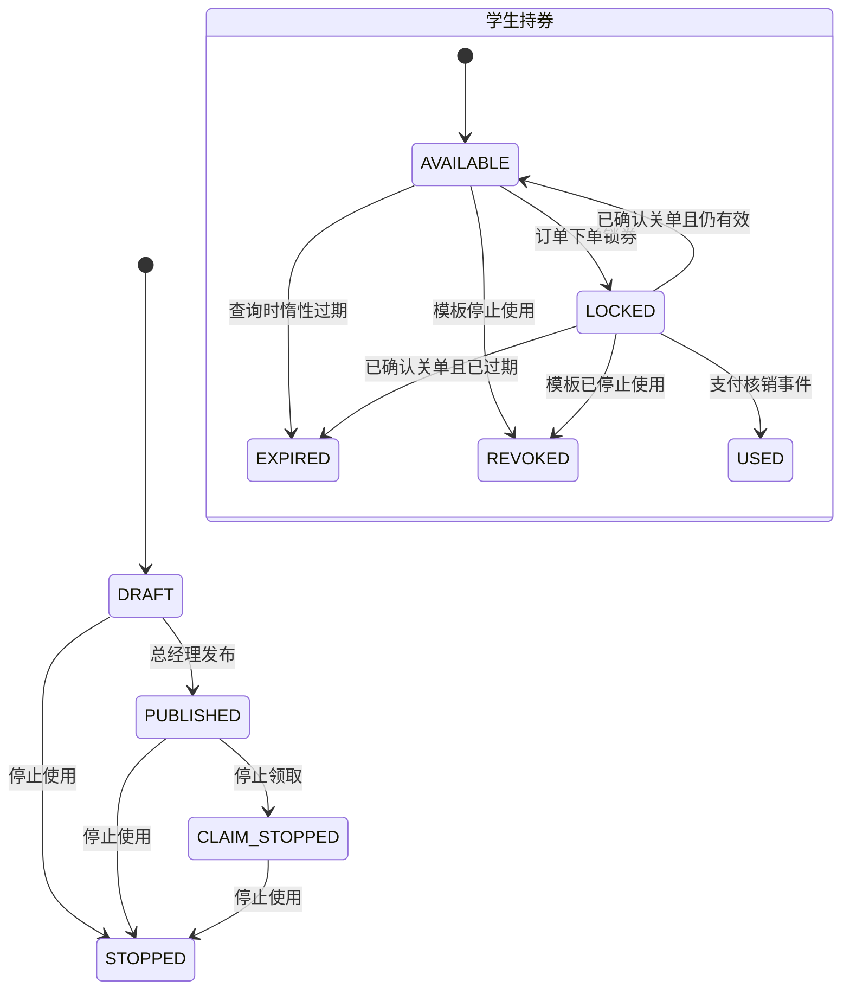

# 优惠券服务

## 当前范围与实现状态

优惠券由独立的 `coupon-service` 管理，学生通过已有 `order-service` 结算时主动选用。本项目首期选择
**平台发行、平台承担成本的固定满减券**：具备全平台数据范围的总经理创建活动，学生自行领取，订单服务在下单时重新核验并锁定。

这个方案把活动规则、领券库存、用户持券、订单金额和资金承担记录放在明确的服务边界内。发行主体与出资主体分开保存，便于后续评估商家券或平台与商家联合出资；首期不开放商家发行或分摊成本，也不在学生端加入管理功能。

| 当前支持                                           | 首期不包含                                          |
|----------------------------------------------------|-----------------------------------------------------|
| 满足最低消费后减固定金额；适用范围为全校或指定窗口 | 折扣券、无门槛券、券码、自动派券、多个优惠叠加      |
| 总经理创建、发布、停止领取或停止使用平台券         | 店铺经理发行、商家承担成本、平台与商家联合分摊      |
| 学生领取、查看本人可用券、结算时主动选择           | 自动替学生选券、客户端预估最终优惠                  |
| 订单服务锁券、确认支付后核销、确认关单后释放       | Vue 管理页面；当前已知工作区没有专用 Vue 管理端仓库 |

代码、迁移和文档已在独立 worktree 中形成；目前只完成静态检查，未完成开发库迁移、服务启动或真实链路验收。因此本文件描述的是
**已提交到 worktree 的实现方案和源码状态**，不表示功能已经部署。

## 发行与资金承担

发行和出资在数据模型中是两个概念：`issuer_type` 表示谁创建并发布活动，`funding_party` 表示谁承担实际优惠成本。首期两者都固定为
`PLATFORM`，每笔锁券流水记录 `platform_funded_amount`，`window_funded_amount` 固定为 0。

首期活动由总经理操作，且服务端会再向 `user-service` 核验操作者是否具有平台范围。不能仅凭前端隐藏入口决定管理权限。学生身份从已验签
JWT 读取，领券和查询接口不接受请求体中的 `userId`。

后续如果产品要支持店铺券，应分别确定发行权限、可用窗口、活动预算上限、撤销规则和账务归属，再增加店铺出资流水及审批边界；如果做联合券，应在每笔用券流水保存各承担方的金额快照，并保证承担金额之和等于订单优惠。上述能力不属于本期实现。

## 服务边界与代码结构

`coupon-service` 独占 `coupon_db`，不直接读写用户、商品、订单或支付数据库。需要确认管理者平台范围时调用 `user-api`，校验窗口范围时调用
`product-api`。订单锁券与释放通过 `coupon-api` 的内部 Feign 契约调用。跨库 ID 只作业务关联，不创建跨服务外键。

```text
coupon-api/                              订单与优惠券服务共享的锁券、释放及支付事件契约
coupon-service/
  controller/                           学生、管理和订单内部 HTTP 入口
  service/、service/impl/                优惠券规则、生命周期及平台范围校验
  mapper/、model/                        coupon_db 的 SQL 访问与持久化对象
  dto/、vo/、enums/                      管理请求、列表投影和状态定义
  messaging/                            支付成功核销事件消费者
  config/、security/                     JWT、内部令牌和服务配置
order-api/                               券服务确认核销后回执订单 Outbox 的内部契约
order-service/                           服务端重新核价、金额快照、支付 Outbox、退款与关单编排
order_system_cloud_user/                 CUSTOMER 领券页、结算选券及优惠金额展示
docs/database/migrations/                coupon_db 与 order_db 迁移脚本
```

优惠券规则与订单金额事实分属不同服务：券服务验证资格并锁定固定优惠额；订单服务持有商品报价、优惠分摊和实际应付快照。支付服务只使用订单服务返回的
`payableAmount`，退款以订单行实付快照为上限。

## 学生与管理接口

以下网关前缀由静态配置样例中的优惠券路由提供；最终是否可访问仍取决于当前 Nacos 配置是否发布。

| 身份                         | 方法与路径                                           | 作用                                            |
|------------------------------|------------------------------------------------------|-------------------------------------------------|
| `CUSTOMER`                   | `GET /api/coupons/claimable`                         | 查询当前开放领取且有剩余库存的模板              |
| `CUSTOMER`                   | `POST /api/coupons/{templateId}/claim`               | 按 JWT 中的本人 ID 领取；每人每模板限领一张     |
| `CUSTOMER`                   | `GET /api/coupons/mine?status=AVAILABLE`             | 查询本人优惠券；`status` 由服务端按状态枚举校验 |
| `GENERAL_MANAGER` + 平台范围 | `GET /api/coupons/admin/templates`                   | 查询有界的模板管理列表                          |
| `GENERAL_MANAGER` + 平台范围 | `POST /api/coupons/admin/templates`                  | 创建平台预算满减券草稿                          |
| `GENERAL_MANAGER` + 平台范围 | `POST /api/coupons/admin/templates/{id}/publish`     | 发布草稿                                        |
| `GENERAL_MANAGER` + 平台范围 | `POST /api/coupons/admin/templates/{id}/stop-claims` | 停止新领取，已发出的券仍可使用                  |
| `GENERAL_MANAGER` + 平台范围 | `POST /api/coupons/admin/templates/{id}/stop-use`    | 停止新锁券并撤销尚未锁定的持券                  |

管理创建请求包含 `title`、`minSpend`、`discountAmount`、`totalQuantity`、`windowIds`、领取起止时间和使用起止时间。空
`windowIds` 表示全校适用；有值时只对指定窗口适用。发行方和出资方由服务端固定，客户端不能自行指定。

学生模板视图含领取时间、发行总量和剩余量；本人持券视图返回 `userCouponId`、模板 ID、标题、门槛、面额、适用范围、窗口
ID、有效期和状态。持券响应不提供领取时段或发行数量，客户端不得将缺少这些字段当作接口错误。

## 状态与并发规则



- `coupon_template` 的 `claimed_quantity` 通过带状态、时间和剩余量条件的单条 SQL 更新递增；最后一张券并发领取时最多一笔预占成功。插入用户券失败会回滚该预占。
- `UNIQUE(coupon_template_id, user_id)` 是每人每模板限领一张的最终约束。重复领取转为业务冲突，而不是创建第二张持券。
- 锁券按模板行优先、用户券行其次的顺序加锁，并用条件更新保护 `AVAILABLE → LOCKED`；锁定时写唯一订单流水。相同订单重试返回原锁券结果，另一订单不能使用同一张券。
- 锁券时重新核对持有人、券状态、有效期、模板状态、窗口范围和服务端传入的适用金额。`CLAIM_STOPPED` 只关闭领取，已领取的券仍可锁定；
  `STOPPED` 会拒绝新锁券。
- 订单确认支付关闭前不能释放。释放时仍有效则恢复 `AVAILABLE`；已过期则转为 `EXPIRED`；模板已停止使用且券仍有效则转为
  `REVOKED`。已核销券不通过释放接口回退。
- `GET /coupons/mine` 会把本人到期的 `AVAILABLE` 券惰性更新为 `EXPIRED`；不依赖定时任务决定能否下单，订单锁券仍再次核验有效期。
- 支付核销消息按订单和持券状态幂等处理；异常抛出后由 RocketMQ 重试。只有券服务已提交本地核销后才回执确认订单 Outbox。

## 订单金额、支付与退款

订单服务先按商品服务报价构建订单及明细，再以用户券 ID、认证用户 ID、订单号、窗口 ID 和原价适用商品金额调用
`/internal/coupons/lock`。客户端不提交优惠金额；券服务返回固定优惠额，订单服务再次校验响应身份、金额精度和折后应付必须大于零。

优惠按各订单行原价比例分摊，计算和保存精确到分的 `line_discount_amount` 与 `line_payable_amount`
；舍入余数由订单行按确定顺序承接，并校验所有行的优惠和应付金额与订单总额守恒。订单头保留原价 `total_amount`，同时保存
`user_coupon_id`、券标题、`discount_amount` 和 `payable_amount`。同一幂等键更换券会形成不同请求摘要，不能重放成另一种支付金额。

订单创建与取消沿用 Seata AT：下单中锁券、保存金额快照和扣减库存属于同一全局事务；任一必要分支失败则整体回滚。取消/超时流程必须先得到支付服务
`CLOSED`，并成功迁移订单状态及回补库存，之后才调用 `/internal/coupons/release`。支付服务返回 `PAID`
时订单按其持久化支付时间推进状态，不释放锁券；返回未知状态或服务异常时取消失败关闭。

支付确认的订单本地事务写入 `order_coupon_consume_outbox`，其中只包含稳定事件号、订单号、用户券 ID 和固定消息体。Outbox 状态依次为
`PENDING`（待发送）、`PUBLISHED`（已进入 Broker，等待券服务回执）、`CONFIRMED`（券服务提交核销后确认）。券消费者先调用券服务本地事务核销，再以
`X-Internal-Token` 回调 `/internal/orders/coupon-consume/confirmed`。未确认事件按指数退避重发，最大等待间隔 300
秒；重复消息不会重复核销。

退款支付事实必须匹配 `payable_amount`。每行可退金额使用该行的 `line_payable_amount`
，按剩余可退份数分摊并将最后剩余份数承接尾差，已申请/已处理的额度也参与上限检查，避免把平台优惠额当现金退回。

## 数据表与迁移

| 数据库      | 表                            | 责任                                                       |
|-------------|-------------------------------|------------------------------------------------------------|
| `coupon_db` | `coupon_template`             | 满减规则、领取与有效时间、平台出资标记、领取总量和模板状态 |
| `coupon_db` | `coupon_template_window`      | 限定适用窗口；全校范围不需要窗口行                         |
| `coupon_db` | `user_coupon`                 | 学生持券、有效期快照、当前订单绑定和持券状态               |
| `coupon_db` | `coupon_use_record`           | 每订单唯一的锁定/核销/释放流水和优惠资金承担快照           |
| `coupon_db` | `coupon_admin_action_record`  | 模板创建、发布、停领和停用审计                             |
| `coupon_db` | `undo_log`                    | Seata AT 回滚镜像，支撑订单跨服务事务                      |
| `order_db`  | `orders`、`order_items`       | 原价、折扣、应付、券标题及订单行优惠快照                   |
| `order_db`  | `order_coupon_consume_outbox` | 支付成功后的核销消息及消费回执状态                         |

迁移文件：

- [`coupon_db/V1__create_coupon_tables.sql`](database/migrations/coupon_db/V1__create_coupon_tables.sql)
  ：创建独立数据库、账号、表和索引；表使用 `IF NOT EXISTS`，执行前仍需核对账号权限及已有 schema。
- [`order_db/V10__add_coupon_amount_snapshots.sql`](database/migrations/order_db/V10__add_coupon_amount_snapshots.sql)
  ：为订单与订单行增加金额快照、回填旧订单，并创建 Outbox。`ALTER TABLE` 是一次性迁移，不能不检查就重复执行。

执行顺序应为：核对目标确为开发库、对照现有表列和索引、准备可恢复备份，然后执行迁移并查询字段、约束、索引及 `undo_log`
。不得仅凭脚本存在就认为目标数据库已经迁移。

## 运行配置与接入

- 服务发现名 `coupon-service`，本地端口 `9112`；数据库 URL、用户名和密码使用 `COUPON_DB_URL`、`COUPON_DB_USERNAME`、
  `COUPON_DB_PASSWORD`，默认指向共享 MySQL 的 `coupon_db`。
- JWT 校验复用项目公钥、issuer 和 Redis token 黑名单。学生接口只放行 `CUSTOMER`；管理接口同时要求 `GENERAL_MANAGER`
  与平台范围；订单内部接口校验 `X-Internal-Token`。
- Seata 事务组沿用 `order-system-tx-group`；coupon 服务是订单全局事务的 RM，必须能访问同一 Seata TC，并且
  `coupon_db.undo_log` 存在。
- `coupon-mq` profile 配置 RocketMQ topic `order-coupon-paid-v1`。订单服务在其活动 profile 下也必须加载该 profile，持续发布订单
  Outbox；显式环境 profile 已用 `spring.profiles.include` 保持券消费/发布配置启用。
- [`docs/nacos/gateway-service.yaml`](nacos/gateway-service.yaml) 增加了 `/api/coupons/**` 业务路由和
  `/api/coupons/v3/api-docs` 文档路由；这只是仓库配置样例，活动 Nacos 配置仍需部署时发布。
- `docker-compose.yml` 只编排共享基础设施，没有逐个启动 Java 服务；优惠券服务复用现有 MySQL、Nacos、Seata、Redis 和
  RocketMQ，不增加一个独立数据库容器。
- `INTERNAL_SCOPE_TOKEN` 必须在订单、用户、商品和优惠券服务之间一致；部署环境应配置高熵随机值，不能沿用示例凭据。

## 学生端交互与权限边界

`order_system_cloud_user` 只为 `CUSTOMER` 提供“我的优惠券”入口、可领取/我的券列表和结算选券。学生选券仅提交 `userCouponId`
；不在客户端自行过滤门槛、计算最终折扣或信任券面额。提交订单后以订单响应的 `totalAmount`、`discountAmount`、`payableAmount`
展示最终金额。接口失败通过下拉刷新重试，重复领券冲突后切换到“我的券”。

页面切换账号时清除旧账号结算和券快照，旧异步响应不能覆盖新会话；待确认下单草稿按用户 UUID 隔离。管理角色的创建、发布和停用功能只提供后端接口，本期不接入
uni-app；需在专用 Vue 管理端仓库接入后再做管理界面。

## 目录与后续计划

| 阶段                   | 内容                                                                                                            | 验收                                                           |
|------------------------|-----------------------------------------------------------------------------------------------------------------|----------------------------------------------------------------|
| 首期源码（已实现）     | 独立券服务、平台预算满减券、学生领取与选券、订单金额快照、Seata 锁券/释放、支付 Outbox 与核销确认、退款实付上限 | 静态检查通过；尚未构建、测试、启动或迁移数据库                 |
| 开发库迁移（待完成）   | 检查 `coupon_db` 和 `order_db` 现状、备份、执行 V1/V10 并复核                                                   | 表、字段、索引、历史回填及 `undo_log` 与模型一致               |
| 运行联调（待完成）     | 发布 Nacos 配置，启动基础设施和服务，验证 JWT、Feign、Seata、RocketMQ                                           | 业务失败回滚券锁；支付成功最终核销；取消只释放 CLOSED 订单的券 |
| 管理端接入（待接入）   | 在用户专用 Vue 管理端接入总经理平台范围的模板创建和生命周期操作                                                 | 后端角色及数据范围仍是授权最终防线                             |
| 后续业务扩展（待评估） | 店铺券、联合出资、自动派券或更多优惠类型                                                                        | 先确定发行权限、承担方结算、撤销和并发规则，再增加字段与状态   |

开发库迁移和全链路运行验证前，不应把优惠券能力描述为已上线。后续每次更改出资方、范围或状态规则时，需同步更新 API
契约、数据库注释、订单快照和本文件。

## 静态检查与未验证项（2026-11-17）

本次已对后端、学生端运行 `git diff --check`，并以 XML 解析器检查根 POM、`coupon-api`、`coupon-service`、`order-api` 和
`order-service` POM。已静态检查订单金额调用点、Feign 客户端扫描、消息 profile、权限边界和迁移字段。未运行 Maven、Maven
Wrapper、Java 测试、前端构建或服务启动。

此前实施时开发 MySQL 不可连接，因此当时未执行迁移。2026-11-18 已通过 WSL Docker 连接本机 `127.0.0.1:9095`，确认目标库和账号不存在后成功执行
coupon_db V1，核验 6 张表及服务账号登录；同批完成推荐库
V1/V2。实际结果见[开发库迁移记录](database/2026-11-18-coupon-recommendation-migration.md)。order_db V10
本次仍未执行，服务运行及全链路验证仍待完成。

静态 Nacos 配置尚未发布到运行环境。还需在目标环境验证：订单全局事务 XID 能否跨 Feign 回滚锁券、窗口范围读取和平台范围授权、Outbox
消费回执和死信后的退避重投、RocketMQ binding、生产 profile、支付/退款金额与页面接口。优惠券管理页面需等 Vue 管理端仓库确认后接入。
