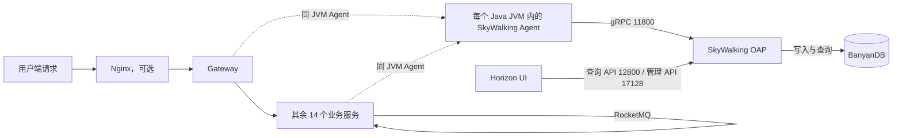

# 全量 SkyWalking 链路追踪设计

> 状态：用户已于 2026-11-18 确认；按该设计进入实施。
> 范围：项目内全部 15 个可独立启动的 Java 后端服务，以及本地 Docker Compose 中可选的 Gateway 容器。
> 当前目标：让一次 HTTP 请求能够跨 Gateway、Feign 服务调用和已支持的 RocketMQ 消息继续关联，并在 SkyWalking 中定位慢调用与错误。

## 1. 背景与现状

项目进度文档记录了“链路追踪和监控采用 SkyWalking”，但仓库当前没有 SkyWalking OAP、存储、UI 或 Java Agent 配置。业务 Java 服务通常由 IDEA 在 Windows 宿主机启动；`docker-compose.yml` 仅提供可选 Gateway 容器。

此前推荐服务不可用的日志已经暴露过独立的 HTTP 参数名问题。SkyWalking 可以展示调用经过的服务、耗时和异常，帮助定位问题；它不会修复接口参数绑定或服务业务错误。本次设计只负责接入观测链路，不把已有业务故障处理混入链路追踪改动。

## 2. 目标与边界

### 目标

- 覆盖全部 15 个 Java 服务进程，服务在 SkyWalking 中使用独立名称。
- 覆盖本机 IDEA 启动与 Compose Gateway 容器两种运行方式。
- 记录 HTTP 服务端、Feign/HTTP 客户端、数据库调用及可兼容的 RocketMQ 生产和消费调用，使同步调用和已支持的异步调用可以按 Trace ID 检索。
- 提供可复用的本地启动、IDEA 配置、故障排查及验收说明。
- 将 Agent 二进制留在本地忽略目录，不把发行包或 JAR 提交到 Git。

### 不在本次范围

- `common-*`、`*-api` 等共享库不是独立 JVM，不需要单独接入。
- 不修改业务 API、SQL、数据库结构或业务结果，也不把 SkyWalking Maven 依赖作为默认接入方式。若运行验收确认 RocketMQ Agent 插件无法跨生产者/消费者传播 Trace 上下文，本任务允许在现有消息边界增加最小的上下文传递适配；届时只增加完成该能力所需的追踪 API 依赖，并单独列为实现步骤，不改变消息内容和业务语义。
- 不接入 uni-app、Nginx、MySQL、Redis、Nacos、RocketMQ Broker 等非 Java 应用进程的独立探针；数据库和缓存调用仍由 Java Agent 的客户端插件呈现为服务 Trace 中的子 Span。
- 不启用日志采集、持续性能剖析或自定义业务指标；首期集中在 Trace、服务拓扑和 Agent 默认运行指标。
- “全量”指所有 Java 服务都加载 Agent，不代表必须保存每一条生产请求；采样策略保留为运行配置，开发环境先使用 Agent 默认策略。

## 3. 方案选择

选择 **自托管 SkyWalking + BanyanDB + Horizon UI + SkyWalking Java Agent**，由项目 Compose 以独立 `skywalking` profile 提供本地观测后端。Java Agent 以外置 `-javaagent` 接入，不修改服务依赖。

| 组件 | 拟固定版本 | 选择理由 |
|---|---:|---|
| SkyWalking OAP | `11.1.0-java21` | 当前官方版本；选 Java 21 镜像变体，便于本地版本统一 |
| BanyanDB | `0.11.2` | 与 OAP 11.1 的 `0.11` 服务端 API 兼容，独立命名卷保存观测数据 |
| Horizon UI | `horizon-1.1.0` | 官方新 UI，与 OAP 11.1.0 对应 |
| SkyWalking Java Agent | `9.8.0` | 支持 JDK 8–25，覆盖项目 Java 21 |

这些版本依据 2026-11-18 查到的 SkyWalking 官方发行说明与部署文档；OAP、BanyanDB 和 UI 版本必须按兼容说明成组固定，不能使用滚动 `latest` 标签。

### 备选方案

- **OpenTelemetry Collector + Tempo/Jaeger**：生态广，但需要另行组合采集器、存储和 UI；当前项目已选择 SkyWalking，换栈没有收益。
- **云厂商 APM**：免维护后端，但依赖账号、网络和费用，不适合作为当前本地开发默认方案。

## 4. 总体结构

SkyWalking Agent 运行在应用 JVM 进程内，以 `-javaagent` 自动增强支持的框架和客户端；OAP、BanyanDB 与 Horizon UI 作为 Compose 服务独立运行。Agent 的服务名按应用服务名逐个设置，不能将 15 个 JVM 汇总到同一个 `SW_AGENT_NAME`。

## 5. Java 服务覆盖清单

下列端口来自各服务当前默认配置；优惠券服务实际端口为 `9113`，推荐服务默认端口为 `9112`。

| 服务 | 本地默认端口 | 服务名 |
|---|---:|---|
| Gateway | 9090 | `gateway-service` |
| 订单 | 9091 | `order-service` |
| 用户 | 9092 | `user-service` |
| 商品 | 9093 | `product-service` |
| 认证 | 9094 | `auth-service` |
| 支付 | 9101 | `payment-service` |
| 文件 | 9102 | `file-service` |
| 购物车 | 9103 | `cart-service` |
| 库存 | 9104 | `stock-service` |
| 评论 | 9105 | `comment-service` |
| 搜索 | 9106 | `search-service` |
| 通知 | 9107 | `notification-service` |
| 统计 | 9111 | `statistics-service` |
| 推荐 | 9112 | `recommendation-service` |
| 优惠券 | 9113 | `coupon-service` |

## 6. Agent 安装与启动约定

### Agent 文件

- 使用官方 `9.8.0` Java Agent 发行包，放入仓库本地目录 `.local/skywalking-agent/`。
- `.gitignore` 忽略该目录；文档记录下载地址、解压结构和需要启用的插件，不提交 Agent 二进制。
- 根据 Agent 9.8.0 官方支持清单，Spring MVC 6、Spring WebFlux 以及 Spring Cloud Gateway 的部分插件位于 `optional-plugins`。实施时按发行包中的插件文件名核对项目依赖，只复制确实需要的兼容插件到 `plugins`；不能只加 Agent 却漏掉这些可选插件，否则 HTTP 入口或 Gateway 路由 Span 可能缺失。
- Feign、MySQL、Druid 与 RocketMQ 也需按 Agent 9.8.0 的官方支持清单核对实际依赖版本。RocketMQ 项目依赖为 5.x，Agent 官方清单包含 RocketMQ 3.x–5.x；仍需检查 Spring Cloud Stream Binder 的实际客户端是否命中该插件。若验收发现上下文断链，允许按前述范围补最小生产/消费上下文适配，以满足跨消息 Trace 目标。

### IDEA 本机服务

- 新增一套可共享的 IDEA `.run` 启动配置，每个服务一份；不改写用户已有的本机运行配置及其私有环境变量。共享配置只携带仓库默认启动值和 SkyWalking 参数，不复制 IDEA 私有配置中的密钥或其他环境变量。
- 每份配置加载同一个本地 Agent JAR，并显式设置两个环境变量：`SW_AGENT_NAME=<对应服务名>`、`SW_AGENT_COLLECTOR_BACKEND_SERVICES=127.0.0.1:11800`。
- 如果某个服务当前只能依靠本机私有环境变量启动，继续使用现有运行配置，并把共享配置中对应的 `-javaagent` 和两项 `SW_AGENT_*` 设置复制进去；共享 `.run` 文件不尝试读取或覆盖这些私有值。
- 运行前先启动 SkyWalking Compose profile，并确保 `.local/skywalking-agent` 已按文档准备好。若 Agent 路径不存在，Java 进程会启动失败，因此文档必须把准备步骤放在前面。

### Compose Gateway

- 复用当前 `Dockerfile` 已支持的 `JAVA_OPTS`，通过只读挂载将本地 Agent 目录映射到容器固定路径。
- Gateway 容器的 `SW_AGENT_NAME` 使用 `gateway-service`，Collector 地址使用 Compose 网络内 OAP 服务名和端口 `skywalking-oap:11800`；本机 IDEA 服务继续使用 `127.0.0.1:11800`。
- Agent 挂载和 `JAVA_OPTS` 只应用于 `app` profile 下的 Gateway 容器，不改变其他业务服务运行模式。

## 7. Compose 端口与数据

新增独立的 `skywalking` profile，包含 BanyanDB、OAP 和 Horizon UI。建议宿主机只绑定回环地址，避免开发观测界面对局域网开放：

| 用途 | 宿主机端口建议 | 容器端口 |
|---|---:|---:|
| Agent gRPC 上报 | 11800 | 11800 |
| OAP 查询 API | 12800 | 12800 |
| OAP 管理 API（Horizon 使用） | 17128 | 17128 |
| Horizon UI 页面 | 18080 | 8081 |

BanyanDB 只在 Compose 内部网络提供给 OAP，不发布宿主机端口。观测数据写入独立命名卷，不与业务数据库共用卷。首期沿用 SkyWalking 11.1 自带的 BanyanDB TTL 默认值：Trace 记录 3 天、分钟级指标 7 天；该期限足以本地排查，也限制观测卷增长。后续如果需要更长留存，再单独修改官方 `bydb.yml` 对应存储组 TTL。Horizon UI 没有默认登录用户；用户已批准生成随机本机管理员密码，密码及其 Argon2id 哈希只写入被忽略的根 `.env`，不进 Git。以上端口在设计阶段检查时没有发现本机监听进程；启动前仍应按本机实际状态确认。

## 8. 文档及仓库修改点

设计获批后的实施预计触及：

1. `docker-compose.yml`：增加 SkyWalking 三个观测组件、独立 profile、健康依赖、回环端口映射和数据卷；为可选 Gateway 容器挂载 Agent 并传递 `JAVA_OPTS` 与环境变量。
2. `.gitignore`：忽略本地 Agent 发行目录。
3. `.run/`：增加 15 份可共享的 IDEA 服务启动配置，覆盖全部服务且不触碰现有本机私有配置。
4. `docs/SKYWALKING_TRACING.md`：记录版本、Agent 安装、可选插件、IDEA 配置、Gateway 容器配置、查询入口、故障排查和验收方式。
5. `README.md` 与相关服务说明：列出 SkyWalking 技术选型、增加推荐服务 `9112`、更正优惠券服务为 `9113`，避免再次混淆两个服务端口。
6. `docs/PROJECT_PROGRESS.md`：只记录已完成的配置事实，并注明尚未运行验收的内容，不把源码配置等同于运行成功。

不会修改任何业务 Java 源码、POM、数据库迁移、服务 API 或现有用户私有 IDEA 配置。

## 9. 风险与验收方向

- `-javaagent` 会给 JVM 增加插桩和上报开销；启用前需确认本机可用内存，出现额外负载时再调整采样和插件。
- `SW_AGENT_NAME` 配错会把多个进程合并显示；每份 IDEA 配置必须与本表服务名一致。
- 本机 Agent 通向 OAP 使用宿主机回环地址，容器内 Agent 使用 Compose DNS。混用地址会出现反复连接失败。
- 只安装基础 Agent 不足以自动覆盖所有 Spring 6 / Gateway 路径，必须加载与当前版本匹配的可选插件。
- Java Agent 可以观察运行中的调用，但不能修复应用的 4xx/5xx、参数绑定、服务发现、下游不可用或消息消费失败。
- 后续验收应检查 15 个服务均在 UI 注册、HTTP/Feign 链路可跨服务关联、错误 Span 与慢调用可检索，并单独检查 RocketMQ 生产到消费的上下文关联。若 Agent 插件不支持项目实际的 Spring Cloud Stream Binder 客户端，则按本设计范围补最小上下文适配后再验收；链路是否关联以实际运行结果为准。
- 本项目 `AGENTS.md` 禁止未获当前请求授权运行 Maven；实施和验收不运行 Maven。任何运行时联调须在非 Maven 路径下执行，并如实记录未覆盖场景。

## 10. 官方资料

- [SkyWalking Java Agent 安装](https://skywalking.apache.org/docs/skywalking-java/v9.8.0/en/setup/service-agent/java-agent/readme/)
- [SkyWalking Java Agent 支持列表与可选插件说明](https://skywalking.apache.org/docs/skywalking-java/v9.8.0/en/setup/service-agent/java-agent/supported-list/)
- [SkyWalking Java Agent 配置覆盖方式](https://skywalking.apache.org/docs/skywalking-java/v9.8.0/en/setup/service-agent/java-agent/setting-override/)
- [Apache SkyWalking APM 11.1.0 发布说明](https://skywalking.apache.org/events/release-apache-skywalking-apm-11.1.0/)
- [Apache SkyWalking Horizon UI 1.1.0 发布说明](https://skywalking.apache.org/events/release-apache-skywalking-horizon-ui-1-1-0/)
- [BanyanDB Docker 安装](https://skywalking.apache.org/docs/skywalking-banyandb/latest/installation/docker/)
- [SkyWalking 11.1 BanyanDB 数据留存默认值](https://skywalking.apache.org/docs/main/latest/en/banyandb/ttl/)
- [SkyWalking 官方下载与版本列表](https://skywalking.apache.org/downloads/)
